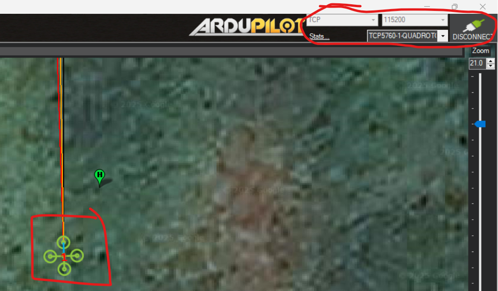
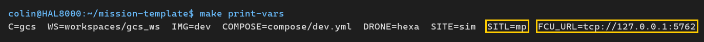
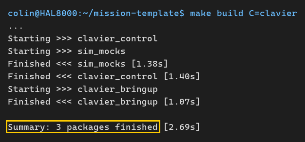
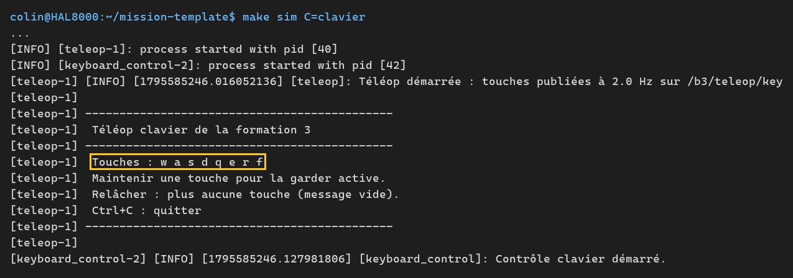
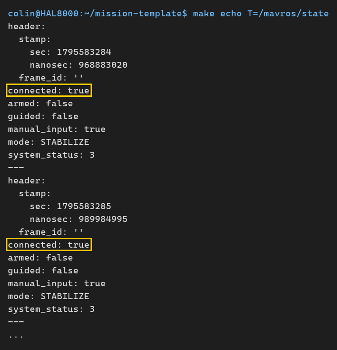
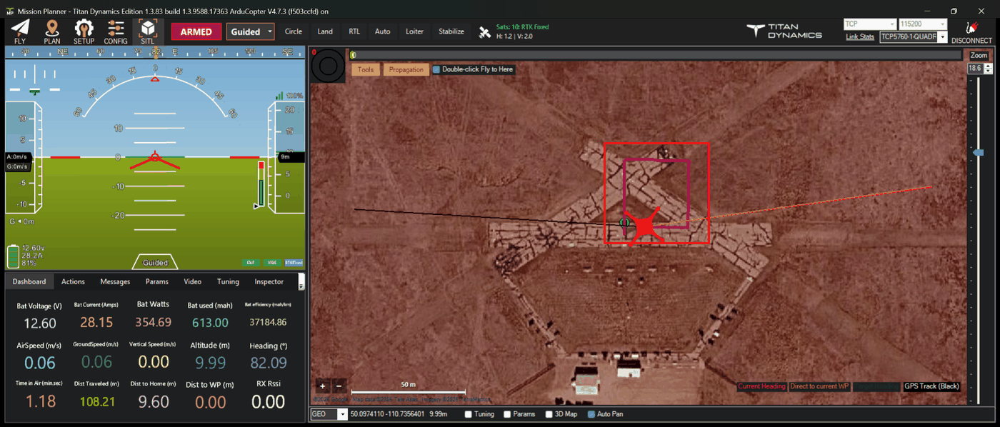
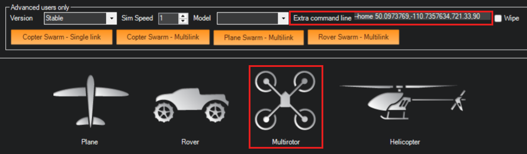

# Formation 5.1 : simulation SITL ArduPilot, la base avant Gazebo

> [!TIP]
> Vous avez déjà fait voler assez de code en simulation dans les formations 3 ou 4 ? Passez directement à la [5.2](5.2-gazebo.md). Faites seulement les sections 3 et 4 d'ici (copier et construire `clavier_ws`) : la 5.2 s'en sert.

Avant de voler sur le vrai drone, tout code de mission est d'abord testé sur un drone simulé. On le teste dans le même environnement que celui qui roulera sur le drone en compétition : mêmes conteneurs, même mavros, même façon de lancer le code. Seule la source change : le simulateur au lieu de l'autopilote.

Dans cette partie, vous reprenez le code du clavier de la formation 3.4, vous le placez dans votre clone de `mission-template` (formation 4), et vous le faites voler contre le simulateur de Mission Planner.

> [!NOTE]
> **Avant de commencer**
> - **Durée** : environ 45 min.
> - **Prérequis** : le SITL de Mission Planner ([formation 1](../1-premier-drone/1-mission-planner-et-zenmav.md), sections 1.2 et 1.4), le clone de `mission-template` avec `make init` ([formation 4.1](../4-env_compétition/4.1-le-repo-vu-de-haut.md)) et la [formation 3.4](../3-ros2/3.4-piloter-au-clavier.md).
> - **À la fin** : le drone simulé décolle, puis se déplace quand vous appuyez sur `w a s d`.
> - **Aide** : Discord, salon Contrôle, fil « Formations et Questions », avec le message d'erreur exact.

---

## 1 - Le drone simulé

Dans Mission Planner : onglet **Simulation**, **Multirotor**, version **Stable**, comme en formation 1, section 1.2.

**Vous devez voir** : le drone sur la carte et la connexion en haut à droite.



Si un mavros des formations 2 ou 3 tourne encore, arrêtez-le : allez dans le dossier de cette formation et tapez `make down`. Un seul mavros à la fois peut se brancher au SITL. Si l'ancien est encore branché, celui de cette formation n'aura pas de place.

---

## 2 - Les trois dossiers

Cette formation utilise deux dépôts que vous avez déjà clonés :

| Dossier | Ce que c'est | Cloné en |
|---|---|---|
| `~/Formations-Controle` | Les formations, avec le code fourni pour chaque exercice. | formation 2 |
| `~/mission-template` | L'environnement de compétition, vide : mavros, les conteneurs, les commandes `make`. Aucun code de mission. | formation 4.1 |

Le code d'une mission ne vit pas dans les fichiers du template. Il vit dans un dossier à part, `mission-template/workspaces/<nom>_ws`, et le template sait le construire et le lancer. C'est le troisième dossier : ici, `clavier_ws`.

Le repo de compétition `aeac-2027` est construit de la même façon : c'est une copie du template, plus les workspaces de la vraie mission. Ce que vous faites ici avec `clavier_ws`, l'équipe le fait là-bas avec le code des Tâches 1 et 2.

Tout le reste se tape dans un terminal Linux : sous Windows, un terminal WSL (celui de VS Code ou un autre) ; sous Linux, un terminal ordinaire. Placez-vous dans votre clone du template et arrêtez ce qui tournerait encore :

```bash
cd ~/mission-template
make down
make print-vars
```

Si `~/mission-template` n'existe pas, refaites le clone et `make init` de la [formation 4.1](../4-env_compétition/4.1-le-repo-vu-de-haut.md).

**Vous devez voir** : `SITL=mp  FCU_URL=tcp://127.0.0.1:5762`. C'est l'adresse du SITL de Mission Planner : mavros va s'y brancher.



---

## 3 - Copier le code du clavier dans le template

Le code du clavier est fourni avec cette formation, dans `Formations-Controle/5-simulation/clavier_ws`. Il contient les deux nodes de la formation 3.4 et un launch file. Mettez d'abord votre clone des formations à jour, puis copiez ce dossier dans `workspaces/` :

```bash
git -C ~/Formations-Controle pull
cp -r ~/Formations-Controle/5-simulation/clavier_ws workspaces/
ls workspaces
```

`cp -r` copie le dossier au complet, de la formation (à gauche) vers le template (à droite). Si votre clone des formations est ailleurs, remplacez `~/Formations-Controle` par son chemin.

**Vous devez voir** : `clavier_ws` à côté de `gcs_ws`.

---

## 4 - Construire

```bash
make build C=clavier
```

`C=clavier` choisit le workspace `clavier_ws`, son package `clavier_bringup` et le launch file `mission.launch.py` de ce package.

**Vous devez voir** : `Summary: 3 packages finished`.



---

## 5 - Lancer (terminal 1)

```bash
make sim C=clavier
```

**Vous devez voir** : l'aide de la téléop, qui liste les touches. Ce terminal lit le clavier : gardez-le au premier plan.



<details>
<summary>Ce que fait <code>make sim</code></summary>

1. Il démarre mavros dans le conteneur `aeac-mavros-sim`, branché sur le SITL.
2. Il démarre le conteneur de développement `aeac-dev`.
3. Il y lance `ros2 launch clavier_bringup mission.launch.py sim:=true`. C'est le même launch file que sur le drone : avec `sim:=false`, il ne démarre rien.

</details>

---

## 6 - Vérifier mavros (terminal 2)

Ouvrez un deuxième terminal :

```bash
cd ~/mission-template
make echo T=/mavros/state
```

**Vous devez voir** : `connected: true`, un message par seconde. `Ctrl+C` pour arrêter.



---

## 7 - Décoller

Le code de mission ne décolle jamais tout seul : sur le vrai drone, c'est le pilote qui passe en GUIDED, arme et décolle. En simulation, vous avez deux façons de jouer ce rôle.

**Avec Mission Planner**, comme le ferait le pilote : **GUIDED**, **Arm**, clic droit sur la carte, **Takeoff**, 10 m (formation 1, section 1.4).

**Ou avec `make takeoff`**, dans le terminal 2 :

```bash
make takeoff
```

`make takeoff` lance une node de test qui passe en GUIDED, arme et décolle à 10 m, puis s'arrête. Elle ne marche qu'en simulation : la commande refuse de la lancer ailleurs que dans le conteneur de simulation. C'est la seule exception à la règle « le code n'arme jamais ».

**Vous devez voir** : le drone monter à 10 m dans le HUD de Mission Planner.

---

## 8 - Voler (terminal 1)

Cliquez dans le terminal 1, puis :

| Touche | Le drone |
|---|---|
| `w` `s` | va au nord, au sud |
| `a` `d` | va à l'ouest, à l'est |
| `r` `f` | monte, descend |
| `q` `e` | tourne à gauche, à droite |

Touche relâchée : le drone s'arrête.

**Vous devez voir** : le drone bouger sur la carte de Mission Planner.



---

## 9 - Fin

1. Mission Planner : mode **RTL**. Le drone revient au-dessus de son point de départ et s'y pose. Prenez cette habitude : c'est le retour le plus sûr. **LAND** le pose sur place, sans revenir.
2. Attendez que le drone soit posé.
3. Terminal 1 : `Ctrl+C`, puis `make down`.

**Vous devez voir** : `docker ps` ne montre plus aucun conteneur `aeac-`.

> [!TIP]
> **Tu as réussi si** :
> - `make echo T=/mavros/state` affiche `connected: true` ;
> - le drone a décollé (Mission Planner ou `make takeoff`) pendant que `make sim C=clavier` tournait ;
> - il a suivi `w a s d` et `r f`, puis il est revenu se poser en RTL.
>
> **À poster** dans le fil « Formations et Questions » : une capture de la carte de Mission Planner avec la trace du vol au clavier.

---

## 10 - Bonus : décoller à Medicine Hat

Par défaut, le SITL démarre loin du terrain de la compétition. Pour le faire démarrer sur la piste de Medicine Hat (AEAC 2027) :

1. Arrêtez le SITL.
2. Onglet **Simulation**, encadré « Advanced users only », champ **Extra command line** :

   ```
   --home 50.0973769,-110.7357634,721.33,90
   ```

   Latitude, longitude, altitude du sol en mètres, cap en degrés (90 = vers l'est).

   

3. Relancez **Multirotor**.

**Vous devez voir** : le drone posé sur la piste. `make sim C=clavier` vole de la même façon : le code lit la position de départ dans l'autopilote, aucune position n'est écrite dans le code.

---

## Quand ça brise

| Ce que vous voyez | Quoi faire |
|---|---|
| `connected: false`, ou rien dans `make echo` | Le SITL tourne-t-il ? `make logs IMG=mavros-sim` pour voir mavros. `docker ps` : un `mavros` ou `b3-mavros` des formations 2 ou 3 prend la place, `make down` dans son dossier. |
| Les touches ne font rien | Cliquez dans le terminal 1 : c'est lui qui lit le clavier. |
| Les touches s'affichent mais le drone ne bouge pas | Il doit être armé, en l'air et en **GUIDED** : `make echo T=/mavros/state` (champs `armed` et `mode`). |
| `make takeoff` répète « refusé par l'autopilote » | Le SITL n'est pas encore prêt (GPS) : attendez, la node réessaie toute seule chaque seconde. |
| `make build` échoue sur un dossier introuvable | `ls workspaces` : `clavier_ws` doit y être (section 3). |
| `ros2: command not found` | Vous êtes sorti du conteneur (`exit`). Passez par `make echo` ou rentrez avec `make shell`. |

Le même environnement fait aussi voler la démo de la formation 4.2 : `make sim C=demo`, puis sa section 2.

---

Suite : [Formation 5.2](5.2-gazebo.md)
