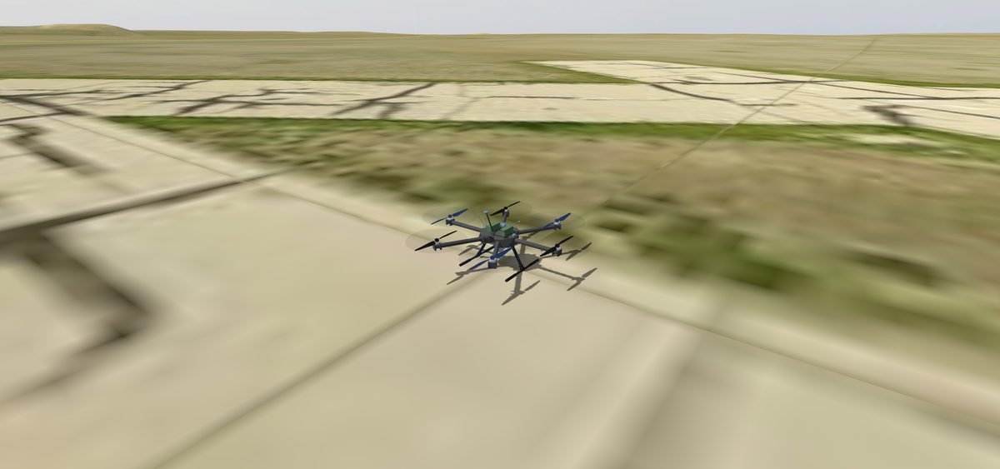
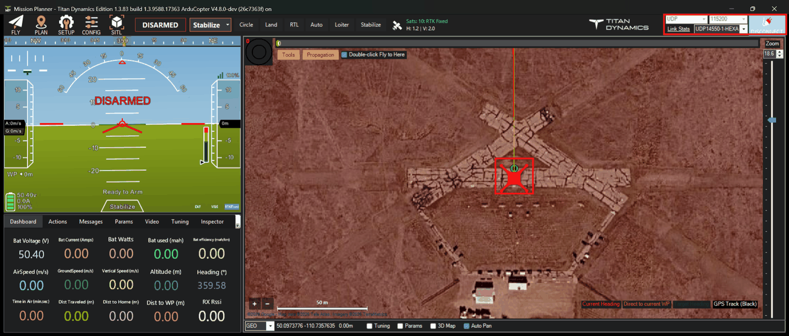
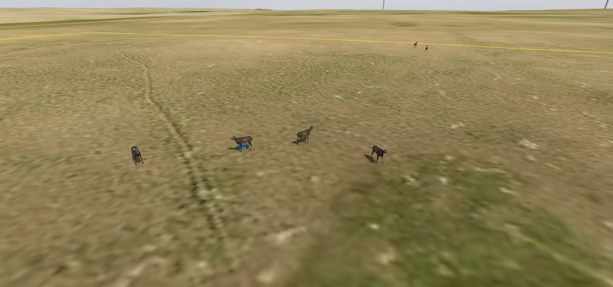
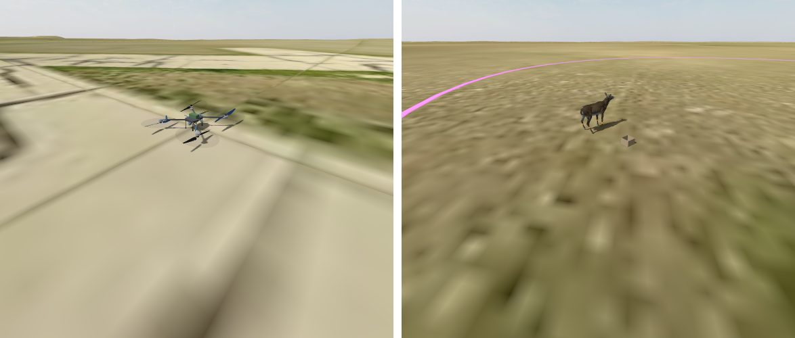
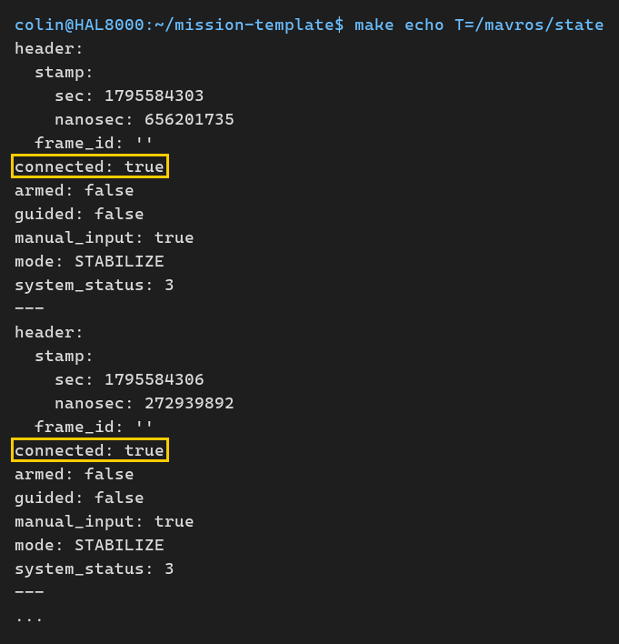
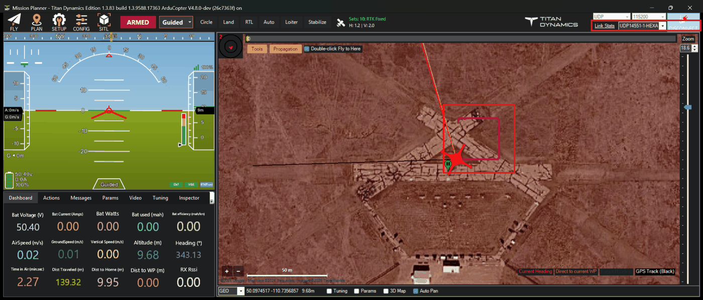

# Formation 5.2 : Gazebo avec Keen-Kestrel

Le SITL de Mission Planner de la 5.1 est rapide et suffit pour tester la logique d'une mission : le drone y est un point sur une carte. Pour tester la vision ou une mission complète, il faut en plus un monde à voir : le relief de Medicine Hat, les cerfs de la Tâche 1, les objets de la Tâche 2. C'est ce que donne Gazebo.

**Gazebo**, en trois lignes :
- C'est un simulateur 3D : il calcule la physique du drone, le relief et ce que voient les capteurs (caméra, lidar).
- ArduPilot y tourne en SITL, comme en 5.1, mais c'est Gazebo qui lui dit où est le drone.
- **Keen-Kestrel** est le dépôt de l'équipe qui met tout ça dans Docker, avec le terrain de la compétition, l'Hexa et l'ODOS.

> [!NOTE]
> **Avant de commencer**
> - **Durée** : environ 1 h 15, dont 30 à 70 min d'installation au premier lancement (sans vous).
> - **Prérequis** : la [formation 5.1](5.1-simulation-sitl-ardupilot.md) finie, ou au moins ses sections 3 et 4 (`clavier_ws` copié et construit). Être membre de l'organisation GitHub `zenith-polymtl` : Keen-Kestrel est privé, demandez l'accès à un lead.
> - **À la fin** : l'Hexa vole dans Gazebo, piloté depuis Mission Planner, puis au clavier avec le code de la 5.1.
> - **Aide** : Discord, salon Contrôle, fil « Formations et Questions », avec le message d'erreur exact.

> [!WARNING]
> Plusieurs postes sur le même réseau (un local, une séance de groupe) peuvent voir les nodes des autres. Si c'est votre cas, faites d'abord la section [Plusieurs postes sur le même réseau](#plusieurs-postes-sur-le-même-réseau), en bas de page.

---

## 1 - Ménage

1. Terminaux de la 5.1 : `Ctrl+C` partout, puis dans mission-template :

   ```bash
   cd ~/mission-template && make down
   ```

2. Mission Planner : arrêtez la simulation de la 5.1. Elle utilise les mêmes ports que Keen-Kestrel.

**Vous devez voir** : `docker ps` ne montre plus aucun conteneur `aeac-`.

---

## 2 - Cloner Keen-Kestrel

```bash
cd ~
git clone https://github.com/zenith-polymtl/Keen-Kestrel
cd Keen-Kestrel
```

**Vous devez voir** : le clone se termine sans erreur. Si GitHub refuse l'accès, voyez [Quand ça brise](#quand-ça-brise).

---

## 3 - Lancer Gazebo (terminal 1)

```bash
make gazebo
```

Le premier lancement construit tout : l'image Docker, le workspace ROS 2, puis le monde de Medicine Hat (internet requis). Comptez 30 à 70 min. Les lancements suivants prennent quelques secondes.

**Vous devez voir** : deux fenêtres, Gazebo (le relief de Medicine Hat, l'Hexa posé au sol) et RViz. Le terminal continue de défiler : c'est normal. Attendez une minute que le GPS du drone soit prêt.



---

## 4 - Se connecter avec une GCS (Mission Planner)

Une GCS (ground control station) est le logiciel qui montre le vol et envoie les commandes du pilote : mode, armement, décollage. Mission Planner en est une ; MAVProxy, plus bas, en est une autre, en ligne de commande. Elles font la même chose avec des interfaces différentes : prenez celle que vous voulez. La simulation tourne sans GCS : elle sert à suivre le vol et, dans cette section et la suivante, à faire décoller le drone, puisqu'aucun code de mission ne roule encore.

Dans Mission Planner, en haut à droite : **UDP**, **Connect**, port **14550**.

**Vous devez voir** : le bouton **CONNECT** devenu **DISCONNECT**, et le drone sur la carte, à Medicine Hat.



<details>
<summary>Sinon : MAVProxy, une GCS dans le terminal</summary>

MAVProxy fait le travail de Mission Planner dans un terminal, avec une petite carte à côté.

1. Déconnectez d'abord Mission Planner : il peut se connecter tout seul au port 14550, et MAVProxy, sur le même port, ne recevrait alors rien. Une seule GCS à la fois.
2. Dans un deuxième terminal : `cd ~/Keen-Kestrel && make mavproxy`.

Pour voler : `mode guided`, `arm throttle`, `takeoff 10`, puis `mode rtl` (ou `mode land`).

</details>

---

## 5 - Voler (GCS)

Comme en 5.1 : **GUIDED**, **Arm**, clic droit sur la carte, **Takeoff**, 10 m (formation 1, section 1.4). `make takeoff` revient en section 7, une fois mission-template branché.

**Vous devez voir** : l'Hexa décoller dans la fenêtre Gazebo. Posez-le avec **RTL** (il revient à son point de départ) ou **LAND** (il se pose sur place).

---

## 6 - Changer de drone et de scène

Dans le terminal 1 : `Ctrl+C`, puis relancez avec une autre commande.

```bash
make t1              # Tâche 1 : l'Hexa et les cerfs
make t2              # Tâche 2 : l'ODOS, le cerf cible et les objets au sol
make t1 CAS=dense    # une autre variante : nominal, dense, epars, ambigu
make scenes          # toutes les scènes, en noms courts
make gazebo DRONE=odos   # l'ODOS sur le terrain seul
```

Les variables s'écrivent en MAJUSCULES : `drone=odos` est ignoré, et c'est l'Hexa qui apparaît. Une nouvelle scène prend environ 20 s à construire la première fois. Si vous suivez le vol dans une GCS, reconnectez-la après chaque relance.

**Vous devez voir** : le bon drone posé sur la piste. Les objets de la scène sont dans la zone de la Tâche, à plusieurs centaines de mètres : reculez la vue de Gazebo (molette) pour les trouver.





---

## 7 - Brancher l'environnement de la 5.1

Le code de la 5.1 vole aussi dans Gazebo. Une seule chose change : `SITL=gazebo`.

**Terminal 1**, Keen-Kestrel : la simulation tourne (`make t1`).

**Terminal 2**, mission-template (le `clavier_ws` de la 5.1 est déjà construit) :

```bash
cd ~/mission-template
make sim C=clavier SITL=gazebo
```

**Terminal 3** :

```bash
cd ~/mission-template
make echo T=/mavros/state
```

**Vous devez voir** : `connected: true`. `Ctrl+C` pour arrêter.



Décollez comme en 5.1 : `make takeoff` dans le terminal 3 (la node de test de simulation), ou Mission Planner. Puis cliquez dans le terminal 2 et volez au clavier.

Mission Planner est facultatif ici : Gazebo montre déjà le drone. Si vous le voulez, connectez-vous en UDP, port **14551** : mavros occupe maintenant le 14550.

**Vous devez voir** : l'Hexa obéir à `w a s d` dans la fenêtre Gazebo.



<details>
<summary>Ce que change <code>SITL=gazebo</code></summary>

mavros écoute le port UDP 14550 de Gazebo au lieu du TCP 5762 de Mission Planner, et il suit l'horloge de la simulation. Le code de mission, lui, ne change pas.

</details>

### Commandes de simulation AEAC 2027

Plus tard, la vraie mission vole de la même façon, avec le repo `aeac-2027` à la place de mission-template :

| Keen-Kestrel (terminal 1) | aeac-2027 (terminal 2) |
|---|---|
| `make t1` | `make sim C=hexa SITL=gazebo SITE=medicine_hat` |
| `make t2` | `make sim C=odos SITL=gazebo SITE=medicine_hat` |

---

## 8 - Fin

1. Si vous avez une GCS : **RTL** ou **LAND**, attendez que le drone soit posé. Sans GCS, arrêter la simulation suffit : le drone est simulé.
2. Terminal 2 : `Ctrl+C`, puis `make down` dans mission-template.
3. Terminal 1 : `Ctrl+C`, puis `make down` dans Keen-Kestrel.

`make down` supprime le conteneur : le lancement suivant refait une initialisation de quelques minutes. Gardez-le pour la fin de la séance.

> [!TIP]
> **Tu as réussi si** :
> - l'Hexa est apparu à Medicine Hat dans Gazebo et Mission Planner s'y est connecté ;
> - il a décollé et s'est posé depuis une GCS (Mission Planner ou MAVProxy) ;
> - `make t2` a fait apparaître l'ODOS ;
> - avec `make sim C=clavier SITL=gazebo`, il a suivi le clavier dans Gazebo.
>
> **À poster** dans le fil « Formations et Questions » : une capture de Gazebo pendant le vol au clavier.

---

## Quand ça brise

| Ce que vous voyez | Quoi faire |
|---|---|
| `git clone` demande un mot de passe ou répond `Repository not found` | Vous n'êtes pas membre de `zenith-polymtl` : demandez l'accès à un lead. |
| `make gazebo` refuse de démarrer à cause de Docker ou de la plateforme | `make configure`, puis lisez ce qu'il signale. |
| Un port « déjà pris » au lancement | Une autre simulation tourne : `make down` ici et dans mission-template, simulation de Mission Planner arrêtée. |
| `DRONE=odos` donne quand même l'Hexa | Vérifiez les MAJUSCULES : `DRONE=`, `SCENE=`, `CAS=`. |
| MAVProxy ne reçoit rien | Mission Planner est connecté sur 14550 : déconnectez-le. |
| Mission Planner ne se connecte plus en section 7 | mavros tient le 14550 : connectez-vous au **14551**. |
| `connected: false` en section 7 | La simulation tourne-t-elle dans le terminal 1 ? Avez-vous bien mis `SITL=gazebo` ? |
| Des nodes ou des topics que vous n'avez pas lancés | Un autre poste du réseau : section suivante. |

## Plusieurs postes sur le même réseau

Keen-Kestrel et mission-template utilisent le domaine ROS 3. Deux postes en domaine 3 sur le même réseau voient les nodes l'un de l'autre. Donnez à votre poste un numéro à vous (entre 0 et 101, différent de celui de vos voisins), le même des deux côtés :

- `~/Keen-Kestrel/.env` : `ROS_DOMAIN_ID=<numéro>`
- `~/mission-template/.env` : `SIM_DOMAIN=<numéro>` (le fichier n'existe pas encore : créez-le, une ligne suffit)

Puis relancez vos commandes `make`.
