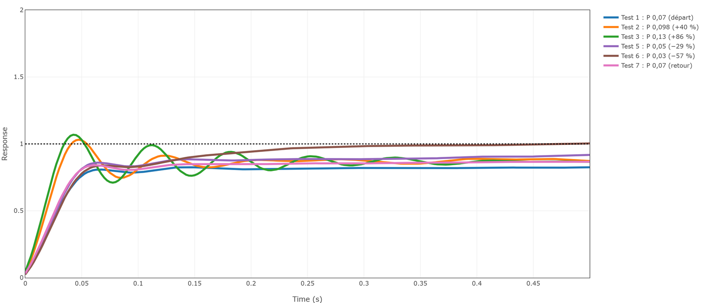
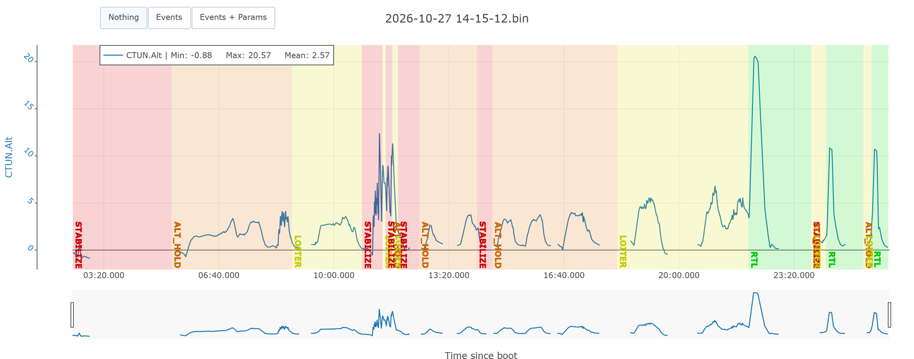
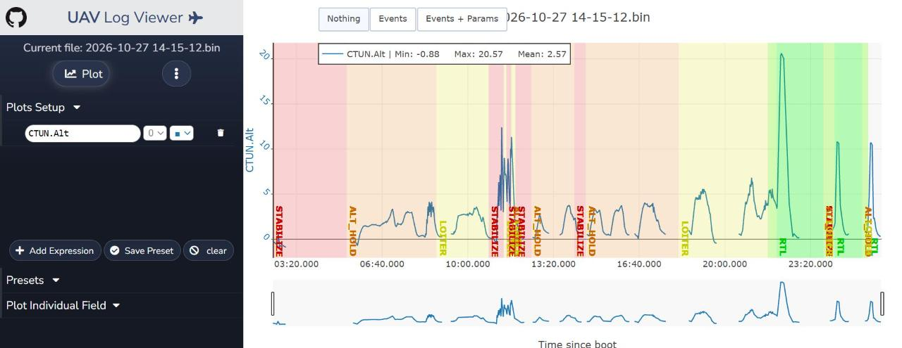
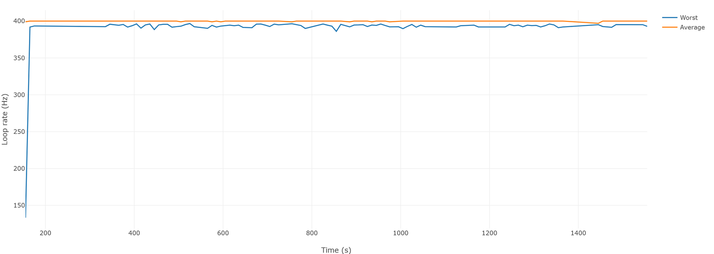
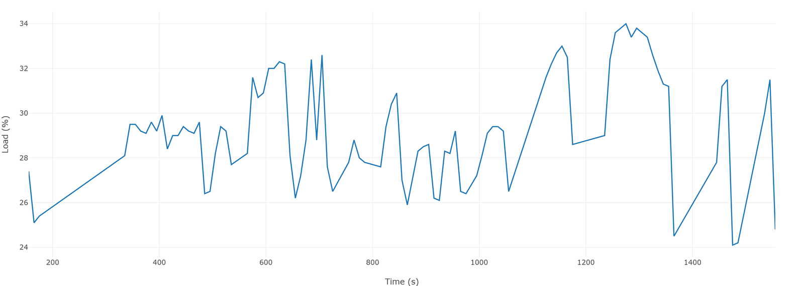
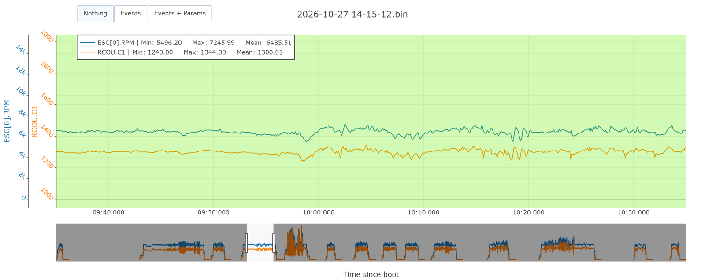

# Formation 9.1 : lire un log

> [!NOTE]
> **À quoi ça sert en compétition**
> Après chaque vol d'essai, quelqu'un doit répondre à la question du pilote : « on change quoi ? ». Avant de toucher un gain, il faut savoir si le drone était sain (vibrations, batterie, processeur) et si les données sont fiables. C'est ce que cette partie installe : ouvrir un log, s'y repérer, et remplir la fiche de santé en dix minutes.

## Objectifs de la formation

À la fin de cette partie, vous serez capable de :

- Expliquer ce qu'un contrôleur essaie de faire et reconnaître un undershoot ou un overshoot sur une courbe
- Situer les contrôleurs de la chaîne ArduCopter et dire lesquels sont actifs dans un mode de vol
- Décrire un vol de tuning type, phase par phase, et briefer un pilote
- Ouvrir un log dans UAV Log Viewer, PID Review, Filter Review et le Hardware Report
- Remplir la fiche de santé d'un vol et dire si les données sont fiables

Prérequis : la formation 1 (Mission Planner, onglet Config, paramètres). Aucun cours d'asservissement : la théorie utile tient dans la section 1.

> [!NOTE]
> **Avant de commencer**
> - **Durée** : environ 1 h 15.
> - **Prérequis** : la formation 1 faite. Un navigateur. Le log `vol-tuning-2026-10-27.bin` (voir [logs/README.md](logs/README.md)).
> - **À la fin** : la fiche de santé du vol du 27 octobre remplie, et un verdict : les données sont-elles fiables ?
> - **Aide** : Discord, salon Contrôle, fil « Formations et Questions », avec une capture de ce que vous voyez.
> - **À poster à la fin** : votre fiche de santé remplie (section 5.6).

La formation 9 se lit dans l'ordre : 9.1 (ce document), puis [9.2 vibrations et filtres](9.2-vibrations-et-filtres.md), [9.3 les rates](9.3-les-rates.md) et [9.4 la chaîne complète et la démarche](9.4-chaine-complete-et-demarche.md). C'est l'ordre dans lequel les conclusions sont valides : on ne juge pas un contrôleur derrière un filtre qui le retarde.

---

## 1 - Ce que le tuning veut dire

### 1.1 - Une consigne, une mesure, un écart

Un contrôleur reçoit une **consigne** (« tourne à 100 degrés par seconde ») et une **mesure** (« tu tournes à 82 degrés par seconde »). Il calcule l'écart et commande les moteurs pour le réduire. Dans les outils ArduPilot, la consigne s'appelle **target** ou **desired**, la mesure **actual**, l'écart **error**.

Le tuning, c'est régler la façon dont le contrôleur transforme l'écart en commande. Trop timide : le drone traîne derrière la consigne. Trop nerveux : il la dépasse et oscille. Toute l'analyse consiste à superposer target et actual et à décider dans quel sens bouger.

### 1.2 - P, I, D en trois phrases

- **P (proportionnel)** pousse proportionnellement à l'écart. Plus P est grand, plus la réponse est rapide. Trop grand, elle dépasse et oscille.
- **D (dérivé)** freine selon la vitesse à laquelle l'écart change. C'est l'amortisseur. Mais il amplifie le bruit et les vibrations, et il fait chauffer les moteurs.
- **I (intégral)** accumule l'écart qui reste et le corrige : un drone qui penche toujours un peu à cause d'une batterie décentrée.

Certains contrôleurs de la chaîne n'ont qu'un P. On dit quand même « les PID ».

### 1.3 - L'échelon et ses trois réponses

Pour juger un contrôleur, on lui donne une consigne brutale (un coup de stick franc) et on regarde comment la mesure la rejoint : c'est la **réponse à l'échelon** (step response). PID Review ramène la consigne à 1 et trace la mesure. Voici le même drone avec trois valeurs de P, toutes prises dans le vol du 27 octobre (la 9.3 les détaille) :



- **Undershoot** (bleu, P 0,07) : la mesure n'atteint pas la consigne ; elle plafonne vers 0,83.
- **Presque correct** (orange, P 0,098) : montée franche, petit dépassement à 1,03, puis stabilisation.
- **Overshoot et oscillation** (vert, P 0,13) : la mesure dépasse à 1,07 puis oscille plusieurs fois avant de se calmer.

**En vol, il y a toujours du retard.** Une consigne instantanée n'existe pas, on bouge un stick. Le tuning ne supprime pas ce délai ; il le réduit en montant les gains, avec les risques qui viennent avec.

### 1.4 - La chaîne de contrôleurs d'ArduCopter

Le drone n'a pas un contrôleur, il en a une chaîne. Chaque étage calcule la consigne de l'étage suivant :

```
Trajectoire (Guided, Auto, Loiter)
   → Position horizontale (P)
      → Vitesse horizontale (PID)
         → Accélération horizontale, convertie en angle
            → Angle roll / pitch / yaw (P)
               → Rate roll / pitch / yaw (PID)
                  → Mix moteur → moteurs

En parallèle, la chaîne verticale :
Trajectoire Z → Position Z (P) → Vitesse Z (PID) → Accélération Z (PID) → throttle
```

Deux conséquences :

- **Un étage mal réglé fait paraître mal réglés tous ceux du dessus.** On règle donc **de bas en haut** : rates, puis angles, puis vertical, puis horizontal.
- **Le mode de vol décide quels étages travaillent.** Pour régler un étage, il faut un vol dans un mode qui l'utilise.

| Mode | Angle et rate | Chaîne verticale | Chaîne horizontale |
|---|---|---|---|
| Stabilize, Acro | oui | non (throttle = pilote) | non |
| AltHold | oui | oui | non |
| Loiter, PosHold | oui | oui | oui |
| Guided, Auto, RTL, Land | oui | oui | oui (trajectoire) |

La [fiche des contrôleurs](fiche-controleurs.md) donne, pour chaque étage, le message de log et les paramètres. Gardez-la ouverte.

---

## 2 - Un vol de tuning type : le 27 octobre

Un log ne sert au tuning que si le vol a été fait pour ça. Le vol du 27 octobre est un vol de tuning type, et il sert de modèle à tous les suivants.

### 2.1 - Les phases



| Phase | Temps (s) | Mode | Ce que fait le pilote | Pour quoi |
|---|---|---|---|---|
| 1. Hover calme | 350 à 395 | AltHold | Rien de franc, petites corrections | Les filtres (9.2) |
| 2. Les axes un à un | 395 à 470 | AltHold | Coups de stick francs en roll, puis pitch, puis yaw, deux fois | Lire les rates (9.3) |
| 3. Les réglages | 736 à 1 068 | AltHold | Un gain changé en vol, puis des coups de stick, six fois de suite | Comparer des réglages (9.3, 9.4) |
| 4. Le vol libre | 1 084 à 1 358 | Loiter | Grands angles, jusqu'à 62 degrés | Voir les limites (9.4) |

Trois choses à retenir de ce découpage :

- **Les modes montent un à un.** Sur un drone qu'on ne connaît pas, on vérifie d'abord qu'il tient en l'air, puis on ajoute un étage de la chaîne à la fois. Ici, le tuning des rates se fait en **AltHold** : le contrôleur tient l'altitude, le pilote n'a plus que les coups de stick en tête. Stabilize marche aussi ; Loiter est à éviter pour les rates, parce que la chaîne horizontale réagit aux coups de stick et brouille la lecture.
- **Un axe à la fois.** Le stick va d'un côté à l'autre, franchement, et le pilote le garde en main : on ne le lâche pas pour qu'il revienne au centre comme un ressort, ça fausse les données.
- **Batteries pleines.** Le voltage donne la poussée, la poussée donne l'autorité. Le 27 octobre, les phases 1 et 2 sont faites à 49,3 V, la phase 3 entre 45,9 et 44,4 V. Il faut s'en souvenir en comparant les deux.

### 2.2 - Ce qui manquait à ce vol

Un vol type n'est pas un vol parfait. Le hover calme de la phase 1 dure 45 secondes, ce qui suffit, mais à 1,5 m du sol, là où le souffle des hélices rebondit ; on le voudrait vers 5 m. On le voit en 9.2.

### 2.3 - Les paramètres de journalisation

À vérifier dans Mission Planner (Config, Full Parameter List) **avant** le vol :

| Paramètre | Valeur voulue | 27 octobre | Pourquoi |
|---|---|---|---|
| `LOG_BITMASK` | « Fast Attitude », « PID » et « IMU Fast » cochés | oui | Sans eux, pas de step response ni de messages `PIDR`, `PIDP`, `PIDY` |
| `INS_LOG_BAT_MASK` | 1 au minimum | 1 | Échantillons IMU rapides pour Filter Review |
| `INS_LOG_BAT_OPT` | bit post-filtre coché (valeur 1, ou 4 pour pré et post) | **0** | Sans lui, Filter Review ne peut qu'estimer l'effet des filtres (9.2) |
| `SERVO_BLH_POLES` | le nombre d'aimants du moteur | 14 | Le RPM de l'ESC est calculé avec ce nombre |
| `LOG_FILE_DSRMROT` | 1 | **0** | Un fichier par armement, plus petit ; ici un seul fichier de 217 Mo pour 13 armements |

### 2.4 - Les failsafes minimaux

Un vol de tuning ne se fait pas sans eux, et le log permet de les vérifier après coup :

| Paramètre | Rôle | 27 octobre |
|---|---|---|
| `BATT_LOW_VOLT`, `BATT_FS_LOW_ACT` | seuil et action batterie faible | 42,0 V, RTL |
| `BATT_ARM_VOLT` | voltage minimal pour armer | **40,0 V, sous le seuil bas** (section 5.4) |
| `FS_THR_ENABLE` | perte de radio | actif |
| `RTL_ALT` | altitude de retour | 20 m, baissé à 10 m en vol à 1 417 s |

> [!TIP]
> **Tu as réussi si** tu peux décrire à un pilote, sans relire, les quatre phases d'un vol de tuning et pourquoi on fait les rates en AltHold et batteries pleines.

---

## 3 - Deux fichiers par vol

- Le **`.bin`** (dataflash) est écrit par l'autopilote sur sa carte SD, plusieurs centaines de fois par seconde. C'est le fichier qu'on analyse. Il se récupère par Mission Planner (Data, DataFlash Logs) ou directement sur la carte SD (dossier `APM/LOGS`) ; sur le terrain, on sort la carte, c'est plus rapide.
- Le **`.tlog`** est écrit par Mission Planner à partir de la télémétrie. Moins de données, mais il garde les messages jaunes et rouges tels qu'ils sont apparus à l'écran. On le rejoue (Data, « Tlog > Kml or Graph ») pour relire un avertissement.

Au-delà de 300 à 400 Mo, les outils web ne chargent plus le fichier. La parade est à la source : `LOG_FILE_DSRMROT` à 1.

---

## 4 - Les outils

| Outil | Pour quoi | À ne pas utiliser pour |
|---|---|---|
| [PID Review](https://firmware.ardupilot.org/Tools/WebTools/PIDReview/) | **Les rates** : target contre actual, step response, gains changés en vol | Les autres contrôleurs |
| [Filter Review](https://firmware.ardupilot.org/Tools/WebTools/FilterReview/) | **Les vibrations en dB**, le placement des filtres, la phase, l'export des paramètres | Les PID |
| [UAV Log Viewer](https://plot.ardupilot.org/) | **Tout le reste** : n'importe quel champ contre n'importe quel autre, modes, événements, moteurs, batterie, GPS | Les step responses |
| [Hardware Report](https://firmware.ardupilot.org/Tools/WebTools/HardwareReport/) | **La santé du système en une page** : calibrations, CPU, loop rate, voltage, messages perdus, paramètres changés en vol | |

Ouvrez le log dans chacun (bouton « Choose File » ou zone de dépôt ; 217 Mo prennent de 10 secondes à une minute). Dans UAV Log Viewer, le premier réflexe est de **tracer l'altitude** (`CTUN.Alt`) : les bandes de couleur donnent les modes, et on se repère dans le vol.



> [!TIP]
> **Tu as réussi si** UAV Log Viewer affiche l'altitude avec ses treize vols, et que les trois autres outils ont chargé le fichier sans erreur.

---

## 5 - La fiche de santé

Avant de conclure quoi que ce soit sur les PID ou les filtres, on vérifie que le drone était sain. Le premier passage est long ; ensuite, dix minutes par vol.

### 5.1 - Le Hardware Report

| Vérification | 27 octobre | Ce qu'on veut |
|---|---|---|
| Version et carte | ArduCopter 4.6.3, MatekH743-bdshot | Savoir sur quelle version on lit les paramètres |
| Calibration de température des IMU | absente | Mineur, à faire un jour |
| Calibration compas contre moteurs | absente | Utile sur les drones à fort courant, pas bloquant |
| Températures | contrôleur 34 °C max, IMU 22 °C max | Rien d'inquiétant (journée froide) |
| Voltage du contrôleur | 3,25 à 3,34 V | Stable ; sous 3,1 V, c'est grave |
| Charge CPU | 24 à 34 %, 29 % en moyenne | **Jamais au-dessus de 50 %** ; chaque notch ajouté la fait monter |
| Loop rate | moyenne jamais sous 397 Hz ; pire boucle isolée de 7,5 ms (133 Hz) | Stable ; des creux répétés cassent le pas de temps des PID |
| Messages perdus | 0 | 0 |
| Paramètres changés en vol | `ATC_RAT_RLL_P`, `ATC_ANG_PIT_P`, `ANGLE_MAX`, `LAND_*`, `RTL_ALT` | Pour savoir quel réglage était actif à quel moment |





### 5.2 - Vibrations et clipping

Dans UAV Log Viewer : `VIBE[0].VibeX`, `VibeY`, `VibeZ`, puis `VIBE[0].Clip`, avec `CTUN.Alt` pour se repérer.


| Mesure | 27 octobre | Seuil de l'équipe |
|---|---|---|
| Moyenne en vol | X 1,2, Y 1,0, Z 1,5 m/s² | **Sous 15 m/s²** |
| Maximum | 14 m/s² (X), au décollage du vol libre à 1 247 s | **Sous 30 m/s²** hors impact |
| Clip | **0** sur tout le vol | Le moins possible, et chaque palier expliqué |

Le clipping compte les fois où l'accéléromètre a dépassé sa plage de mesure. Il vient de chocs physiques (un atterrissage dur, une pièce qui cogne), pas d'un réglage. Zéro sur 24 minutes et 13 atterrissages : la mécanique est saine. Les pics de vibration suivent les manœuvres brusques (le vol libre vers 670 à 700 s, puis le vol agressif après 1 247 s) : c'est normal.

### 5.3 - Moteurs et ESC

- **Le RPM fait-il du sens ?** Pendant le hover de 350 à 395 s, les quatre moteurs tournent en médiane entre 6 360 et 6 480 tr/min. Divisé par 60 : **106 à 108 Hz**, avec des creux vers 93 Hz quand un moteur ralentit pour corriger. C'est le gros pic que vous verrez dans Filter Review. Si le RPM lu était le double ou la moitié de l'attendu, `SERVO_BLH_POLES` serait faux, et on le corrigerait **avant** les filtres.
- **RPM contre sortie PWM** : pendant les coups de stick du premier vol (395 à 470 s), `ESC[0].RPM` et `RCOU.C1` (même moteur) ont la même forme. Si les formes divergent, un ESC ou un câblage a un problème.



- **Température** : 34 °C au maximum. **Courant** : jusqu'à 48 A sur un moteur, à 699 s, quand le pilote met les gaz à fond en Stabilize.

### 5.4 - Batterie : le sag et le seuil d'armement

Message `BAT`, champ `Volt` (voir la vue d'ensemble, section 2.1). Le 27 octobre : 49,5 V au premier armement, 41,5 V à la fin, et un **failsafe batterie à 1 544 s** (41,3 V, sous le seuil de 42,0 V), qui empêche ensuite de réarmer.

Le **sag** est la chute de voltage quand le courant monte. Il compte pour une règle : **`BATT_ARM_VOLT` doit dépasser `BATT_LOW_VOLT` d'au moins le sag**, environ 1 à 1,2 V. Sinon on arme, on décolle, le voltage plonge sous le seuil bas et le drone part en RTL. Le 27 octobre, `BATT_ARM_VOLT` vaut 40,0 V pour un seuil bas de 42,0 V : l'écart est **négatif**, il faut viser environ 43 V.

Le courant du message `BAT` reste à 0,1 A tout le vol : le moniteur de batterie ne mesure pas le courant. Les ESC, eux, le mesurent (`ESC.Curr`). Quand deux sources se contredisent, on cherche laquelle a une raison d'avoir tort.

### 5.5 - Événements, messages, GPS

- **Messages** (`MSG`) : des « ground mag anomaly, yaw re-aligned » à chaque décollage (le compas perturbé près du sol, sans gravité), puis le failsafe batterie et un failsafe radio après l'atterrissage final.
- **GPS** : 11 à 16 satellites, pas de glitch.
- **Hover appris** : `MOT_THST_HOVER` à 0,125, le plancher du paramètre. Le Crash Proof tient en l'air à 12,5 % de throttle : il est très motorisé pour sa masse. On s'en souviendra pour la marge des moteurs (9.4).

### 5.6 - Remplir la fiche

Copiez ce tableau dans votre journal et remplissez-le pour le vol du 27 octobre. Verdict : sain, à surveiller, ou problème.

| Vérification | Où | Valeur mesurée | Verdict |
|---|---|---|---|
| Version, carte | Hardware Report | | |
| Loop rate, charge CPU, voltage du contrôleur | Hardware Report | | |
| Messages perdus | Hardware Report | | |
| Paramètres changés en vol | Hardware Report | | |
| VIBE moyennes et maximales | UAV Log Viewer | | |
| Clip | UAV Log Viewer | | |
| RPM en hover, en Hz | UAV Log Viewer, ESC | | |
| Voltage début, fin, failsafe | UAV Log Viewer, BAT, MSG | | |
| `BATT_ARM_VOLT` moins `BATT_LOW_VOLT` | paramètres | | |
| Journalisation (post-filtre, un fichier par armement) | paramètres | | |
| Satellites, messages inhabituels | UAV Log Viewer | | |

<details>
<summary>Le verdict pour le 27 octobre (à ouvrir après avoir fait le vôtre)</summary>

Sain, données fiables pour le tuning. Deux corrections hors tuning : le seuil d'armement sous le seuil bas, et le moniteur de courant inactif. Deux points de journalisation à corriger pour le prochain vol : le bit post-filtre et un fichier par armement. Le détail est dans [solutions/journal-vol-tuning-2026-10-27.md](solutions/journal-vol-tuning-2026-10-27.md).

</details>

> [!TIP]
> **Tu as réussi si** ta fiche est remplie sur toute la ligne et que ton verdict d'ensemble nomme les deux corrections hors tuning.

---

## 6 - Quand ça casse

| Symptôme | Cause probable | Quoi faire |
|---|---|---|
| L'outil web reste vide ou le navigateur plante | Fichier trop gros | `LOG_FILE_DSRMROT` à 1 pour les prochains vols ; fermer les autres onglets |
| PID Review n'affiche aucune courbe | Ce n'est pas un rate, ou le bit PID manque dans `LOG_BITMASK` | PID Review ne sert qu'aux rates ; le reste se lit dans UAV Log Viewer |
| Filter Review : le bouton « post-filter » est gris | `INS_LOG_BAT_OPT` sans le bit post-filtre | Travailler avec « estimated post-filter » (9.2) ; activer le bit pour le prochain vol |
| Le RPM ESC est le double ou la moitié de l'attendu | `SERVO_BLH_POLES` faux | Corriger, puis seulement régler les filtres |
| `BAT.Curr` reste à zéro | Moniteur sans capteur de courant | Lire `ESC.Curr` ; configurer `BATT_MONITOR` |
| Les courbes d'UAV Log Viewer ne sont pas à la même échelle | Chaque courbe a son axe | Mettre les deux champs sur le même axe (menu à côté du nom du champ) |

---

## 7 - À poster

Dans le fil « Formations et Questions » : votre fiche de santé remplie et une phrase de verdict. La formation continue avec [9.2 vibrations et filtres](9.2-vibrations-et-filtres.md).
