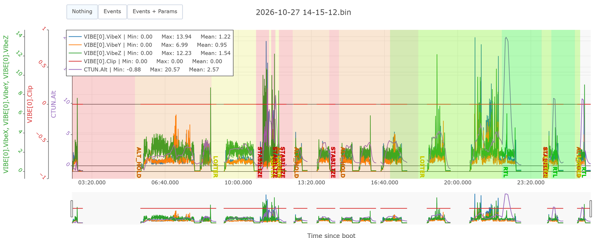
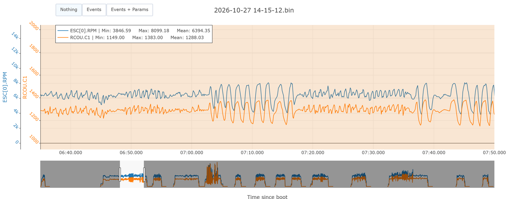

# Formation 9.1 : lire un log

> [!NOTE]
> **À quoi ça sert en compétition**
> Après chaque vol d'essai, il faut répondre à la question du pilote : « on change quoi ? ». Cette partie donne les bases pour y répondre : ce qu'est un contrôleur, comment se fait un vol de tuning, où lire le log, et comment vérifier que le drone était sain avant de toucher un gain.

## Objectifs de la formation

À la fin de cette partie, vous serez capable de :

- Expliquer ce qu'un contrôleur essaie de faire et reconnaître un undershoot ou un overshoot
- Dire quels contrôleurs travaillent dans un mode de vol, et dans quel ordre on les règle
- Décrire un vol de tuning type et briefer un pilote
- Ouvrir un log dans les outils web d'ArduPilot et remplir la fiche de santé

> [!NOTE]
> **Avant de commencer**
> - **Durée** : environ 1 h.
> - **Prérequis** : la formation 1 (Mission Planner, paramètres). Un navigateur. Le log `vol-tuning-2026-10-27.bin` (voir [logs/README.md](logs/README.md)).
> - **À la fin** : la fiche de santé du vol du 27 octobre remplie.
> - **Aide** : Discord, salon Contrôle, fil « Formations et Questions », avec une capture de ce que vous voyez.

La formation 9 se lit dans l'ordre : 9.1, [9.2 vibrations et filtres](9.2-vibrations-et-filtres.md), [9.3 les rates](9.3-les-rates.md), [9.4 la chaîne complète et la démarche](9.4-chaine-complete-et-demarche.md).

---

## 1 - Le principe

### 1.1 - Une consigne, une mesure, un écart

Un contrôleur reçoit une **consigne** (« tourne à 100 degrés par seconde ») et une **mesure** (« tu tournes à 82 »). Il commande les moteurs pour réduire l'écart. Dans les outils, la consigne s'appelle **target** ou **desired**, la mesure **actual**.

Le tuning, c'est régler la façon dont le contrôleur réagit à l'écart. Trop timide : le drone traîne. Trop nerveux : il dépasse et oscille. Toute l'analyse consiste à superposer target et actual, et à décider dans quel sens bouger.

### 1.2 - P, I, D

- **P** pousse proportionnellement à l'écart. Plus grand, plus rapide ; trop grand, ça oscille.
- **D** freine selon la vitesse de l'écart. C'est l'amortisseur, mais il amplifie le bruit et chauffe les moteurs.
- **I** corrige l'écart qui reste dans le temps (une batterie décentrée, du vent).

### 1.3 - La step response

On donne au contrôleur une consigne brutale (un coup de stick franc) et on regarde comment la mesure la rejoint. PID Review ramène la consigne à 1 et trace la réponse. Voici le même drone avec trois valeurs de P, prises dans le vol du 27 octobre :


- **Undershoot** (bleu, P 0,07) : la réponse plafonne sous 1.
- **Presque correct** (orange, P 0,098) : montée franche, petit dépassement, puis stabilisation.
- **Overshoot et oscillation** (vert, P 0,13) : la réponse dépasse puis oscille.

Il y a toujours un peu de retard en vol. Le tuning le réduit, il ne le supprime pas.

### 1.4 - La chaîne de contrôleurs

Le drone n'a pas un contrôleur, il en a une chaîne. Chaque étage donne la consigne du suivant :

```
Position → Vitesse → Accélération → Angle → Rate → Moteurs
```

Deux conséquences :

- **On règle de bas en haut** : rates, puis angles, puis vertical, puis horizontal. Un étage mal réglé fait paraître mal réglés tous ceux du dessus.
- **Le mode de vol décide quels étages travaillent** : en Stabilize, angle et rate ; en AltHold, la chaîne verticale s'ajoute ; en Loiter et en Auto, toute la chaîne.

La [fiche des contrôleurs](fiche-controleurs.md) donne, pour chaque étage, le message de log et les paramètres.

---

## 2 - Le vol de tuning type

Un log ne sert au tuning que si le vol a été fait pour ça. Le vol du 27 octobre sert de modèle.


| Phase | Temps (s) | Mode | Ce que fait le pilote | Pour quoi |
|---|---|---|---|---|
| 1. Hover calme | 350 à 395 | AltHold | Rien de franc | Les filtres (9.2) |
| 2. Les axes un à un | 395 à 470 | AltHold | Coups de stick en roll, puis pitch, puis yaw | Lire les rates (9.3) |
| 3. Les réglages | 736 à 1 068 | AltHold | Un gain changé en vol, puis des coups de stick, plusieurs fois | Comparer des réglages (9.3) |

Les règles à donner au pilote :

- **Monter les modes un à un.** On vérifie d'abord que le drone tient en l'air, puis on ajoute un étage. Les rates se règlent en **AltHold** : l'altitude est tenue, le pilote n'a que les coups de stick en tête.
- **Un axe à la fois, coups francs.** Le stick va d'un côté à l'autre et le pilote le garde en main ; on ne le lâche pas pour qu'il revienne comme un ressort.
- **Batteries pleines.** Le voltage donne la poussée, donc l'autorité du drone.

Avant le vol, dans Mission Planner, vérifier que la journalisation est complète : `LOG_BITMASK` avec « Fast Attitude », « PID » et « IMU Fast », `INS_LOG_BAT_MASK` à 1 et `INS_LOG_BAT_OPT` avec le bit post-filtre (9.2).

> [!TIP]
> **Tu as réussi si** tu peux décrire à un pilote les trois phases et pourquoi on règle les rates en AltHold, batteries pleines.

---

## 3 - Les fichiers et les outils

Le **`.bin`** est le log écrit par l'autopilote sur sa carte SD : c'est lui qu'on analyse. Le `.tlog`, écrit par Mission Planner, sert surtout à relire les messages affichés pendant le vol.

| Outil | Pour quoi |
|---|---|
| [PID Review](https://firmware.ardupilot.org/Tools/WebTools/PIDReview/) | Les rates : target contre actual, step response, gains changés en vol |
| [Filter Review](https://firmware.ardupilot.org/Tools/WebTools/FilterReview/) | Les vibrations et le réglage des filtres |
| [UAV Log Viewer](https://plot.ardupilot.org/) | Tout le reste : n'importe quel champ du log, les modes, les moteurs, la batterie |
| [Hardware Report](https://firmware.ardupilot.org/Tools/WebTools/HardwareReport/) | La santé du système en une page |

Ouvrez le log dans chacun. Dans UAV Log Viewer, premier réflexe : **tracer l'altitude** (`CTUN.Alt`). Les bandes de couleur donnent les modes, et on se repère dans le vol.


---

## 4 - La fiche de santé

Avant de conclure quoi que ce soit, on vérifie que le drone était sain. Après le premier passage, ça prend dix minutes par vol.

| Vérification | Où | Ce qu'on veut | 27 octobre |
|---|---|---|---|
| Loop rate | Hardware Report | stable à 400 Hz | 400 Hz |
| Charge CPU | Hardware Report | sous 50 % | 29 % |
| Voltage du contrôleur | Hardware Report | stable, jamais sous 3,1 V | 3,3 V |
| Messages perdus | Hardware Report | 0 | 0 |
| Vibrations (`VIBE`) | UAV Log Viewer | moyenne sous 15 m/s², pics sous 30 | 1 à 1,5 m/s², 14 au plus |
| Clipping (`VIBE.Clip`) | UAV Log Viewer | 0, ou chaque saut expliqué | 0 |
| RPM des moteurs en hover (`ESC.RPM`) | UAV Log Viewer | cohérent avec le moteur | 6 400 tr/min, soit 106 Hz |
| Batterie (`BAT.Volt`) | UAV Log Viewer | les coups de stick faits batteries pleines | 49,3 V au premier vol |




Deux points méritent une phrase :

- **Le clipping** compte les fois où l'accéléromètre a dépassé sa plage de mesure. Il vient de chocs physiques, pas d'un réglage.
- **Le RPM** se divise par 60 pour donner la fréquence des moteurs, ici environ 106 Hz. C'est le pic qu'on cherchera dans Filter Review (9.2). Le RPM et la sortie moteur (`RCOU`) doivent avoir la même forme :



<details>
<summary>Le verdict pour le 27 octobre</summary>

Sain, données fiables pour le tuning.

</details>

> [!TIP]
> **Tu as réussi si** ta fiche est remplie et que tu sais dire, pour chaque ligne, ce qui serait inquiétant.

---

## 5 - À poster

Dans le fil « Formations et Questions » : votre fiche de santé remplie. La formation continue avec [9.2 vibrations et filtres](9.2-vibrations-et-filtres.md).
