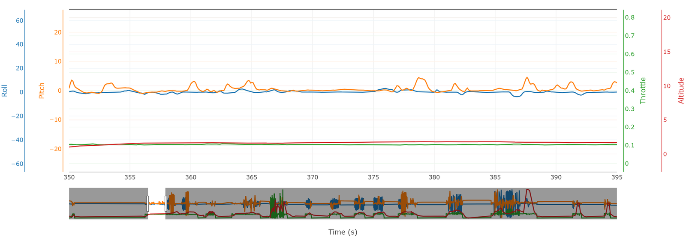
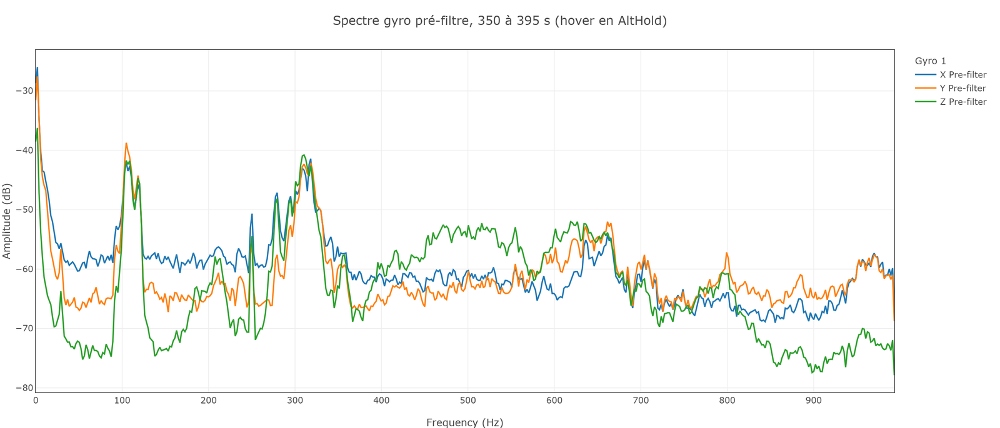
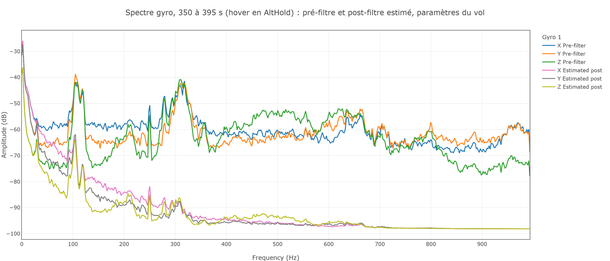
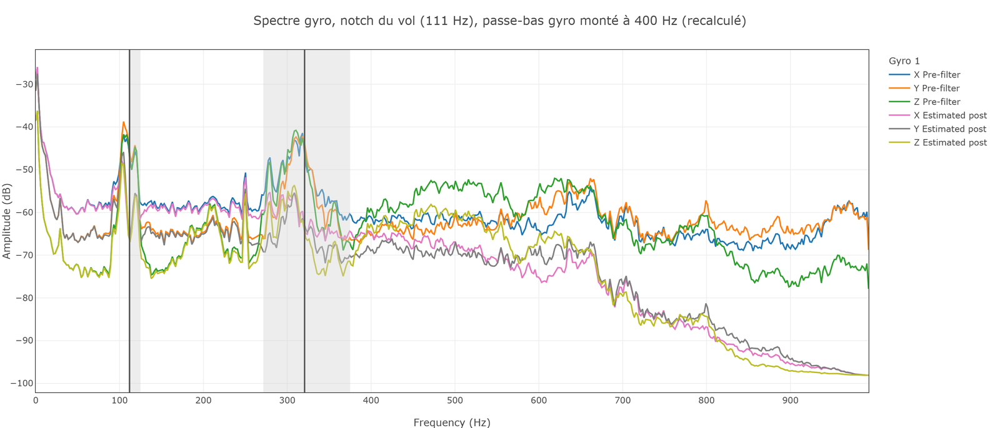
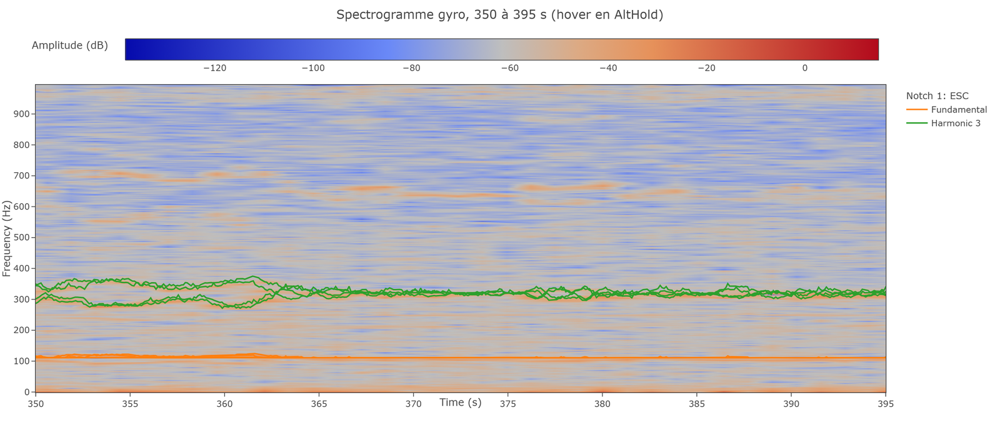
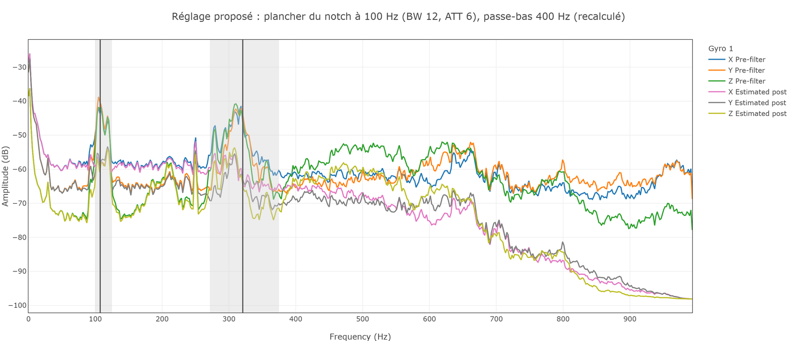
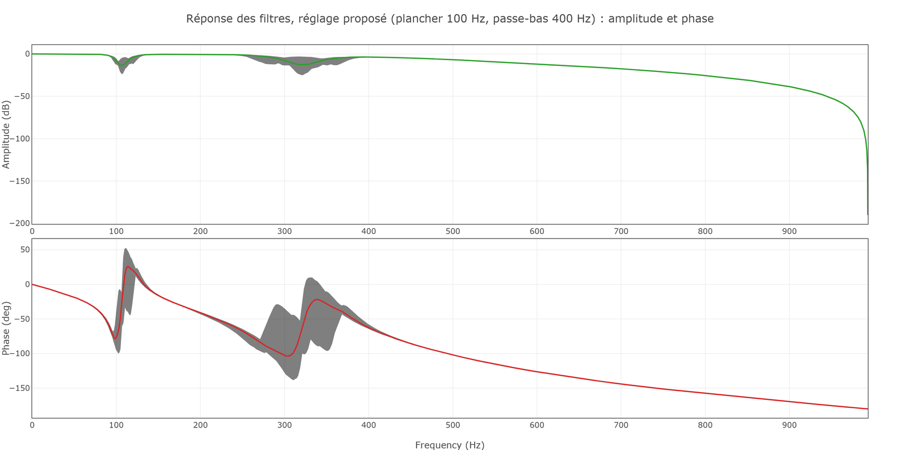

# Formation 9.2 : vibrations et filtres

> [!NOTE]
> **À quoi ça sert en compétition**
> Un drone sur-filtré a l'air mal réglé : il traîne, on monte les gains, il oscille. Un drone sous-filtré chauffe ses moteurs et fait trembler la caméra. Bien placer les filtres, c'est ce qui rend tout le reste du tuning possible, et c'est à refaire à chaque changement d'hélices ou de charge utile, donc avant chaque compétition.

## Objectifs de la formation

À la fin de cette partie, vous serez capable de :

- Expliquer pourquoi on filtre le gyroscope, et pourquoi chaque filtre de trop coûte du retard
- Choisir la portion de vol qui sert aux vibrations, et lire un spectre pré-filtre
- Régler le notch harmonique et le passe-bas gyro dans Filter Review, en recalculant
- Exporter les paramètres, les charger dans le drone et vérifier qu'ils sont appliqués

Prérequis : la formation 9.1, et en particulier le RPM des moteurs (section 5.3). Un notch calé sur un RPM faux filtre à côté.

> [!NOTE]
> **Avant de commencer**
> - **Durée** : environ 1 h 15.
> - **Prérequis** : la formation 9.1 faite, fiche de santé remplie.
> - **À la fin** : un fichier de paramètres exporté de Filter Review qui laisse tous les pics juste sous moins 50 dB avec le moins de filtres possible.
> - **Aide** : Discord, salon Contrôle, fil « Formations et Questions », avec la capture de votre spectre.
> - **À poster à la fin** : la capture « estimated post-filter » finale et le fichier de paramètres.

---

## 1 - Pourquoi filtrer, pourquoi pas trop

Les moteurs tournent, les hélices battent l'air, et la structure vibre à la fréquence de rotation et à ses multiples. L'IMU est fixée sur la structure : le gyroscope mesure, en plus de la rotation du drone, un tremblement permanent vers 106 Hz (les moteurs du Crash Proof en hover, 9.1 section 5.3), à ses multiples, plus les résonances du châssis, des fils et des antennes. Sans filtre, le contrôleur de rate prend ce tremblement pour une rotation et essaie de le corriger ; le D, qui réagit à la vitesse de variation, est le plus touché.

Mais un filtre n'est pas gratuit. Il lisse le signal, et lisser prend du temps : la mesure filtrée est **en retard** sur la réalité. Ce retard se mesure en degrés de phase. Un drone trop filtré réagit en retard à tout.

Deux règles, celles de toute la formation :

- **On met toujours le moins de filtres possible.**
- **La cible est moins 50 dB, pas moins.** Sous ce niveau, une vibration n'a pratiquement plus d'effet sur le contrôleur. Descendre plus bas n'apporte rien et coûte du retard.

Le décibel en deux lignes : l'échelle est logarithmique ; moins 20 dB divise une amplitude par 10, moins 40 dB par 100.

---

## 2 - Choisir la portion de vol

Dans Filter Review, une fois le log chargé, la vue d'ensemble montre le throttle et les modes. On choisit une plage dans « Analysis time » :

- **un hover calme**, sans commandes du pilote, throttle constant ;
- **au moins 20 à 30 secondes**.

Le 27 octobre, la meilleure portion est le hover en AltHold de **350 à 395 s**, juste avant les coups de stick : 45 secondes à 1,5 m, altitude tenue par le contrôleur. Le pilote y fait de petites corrections (les sticks bougent de 50 à 100 µs autour du centre), mais elles ne demandent jamais plus de 20 degrés par seconde : c'est un hover calme. Ce qui compte n'est pas que les sticks soient parfaitement immobiles, c'est qu'aucun mouvement franc ne soit commandé.

Un seul défaut : 1,5 m, c'est près du sol, où le souffle des hélices rebondit. Au prochain vol, on fera le même hover un peu plus haut, à 5 m.

Pourquoi le hover ? Parce que Zenith passe l'essentiel de ses vols en hover : c'est là que les vibrations comptent. On centre les filtres sur le hover, et le notch suit le RPM quand il change.

Entrez 350 et 395, cliquez **Calculate**.

---

## 3 - Lire le spectre pré-filtre

Trois courbes sont proposées : **pre-filter** (ce que le gyroscope mesure), **post-filter** (ce qui arrive vraiment au contrôleur ; grisé ici, faute du bit post-filtre, 9.1 section 2.3) et **estimated post-filter** (l'effet des filtres calculé par l'outil, très proche du réel). Affichez pre-filter seul.

**Avant de lire la suite : qu'est-ce que vous voyez ?**

Réponse

- Un pic net vers **105 Hz**, à moins 39 dB : la rotation des moteurs (environ 6 400 tr/min divisés par 60). C'est le RPM de la fiche de santé.
- Une bosse vers **310 Hz**, à moins 41 dB : la troisième harmonique (3 × 105 = 315). Les hélices ont trois pales, ou une résonance tombe là.
- Une bosse vers **620 Hz**, à moins 52 dB : déjà sous la cible.
- Des petits pics ailleurs : fils, tie-wraps, antennes. Pas nécessaire de savoir quoi est quoi.

Ce qui compte : **ce qui dépasse moins 50 dB**. Ici, le pic moteur et sa troisième harmonique.

---

## 4 - Ce que le drone volait vraiment

Affichez maintenant aussi « estimated post-filter », avec les paramètres du log tels quels (Filter Review les lit dans le log et les préremplit).

**Question : quel est le problème ?**

Réponse

Tout est écrasé : moins 62 dB pour le pic moteur, moins 86 pour l'harmonique, moins 95 au-dessus. On a retiré bien plus que nécessaire, et on le paie en retard.

Le coupable est le **passe-bas gyro** : `INS_GYRO_FILTER` vaut 42 Hz. Un passe-bas coupe tout ce qui est au-dessus de sa fréquence : à 42 Hz, il efface le spectre entier et impose son retard à toutes les fréquences de contrôle. Cette valeur devait passer à 400 Hz après les vols d'août ; elle ne l'a jamais été. C'est l'erreur qui se fait le plus souvent : un paramètre décidé en séance et jamais chargé (section 7).

Affichez la courbe de réponse des filtres (le graphique amplitude et phase en bas de page) : avec le passe-bas à 42 Hz, la phase atteint environ **moins 115 degrés à 50 Hz** et moins 200 à 100 Hz.

---

## 5 - Le passe-bas à 400 Hz, et ce qu'il révèle

Mettez `INS_GYRO_FILTER` à **400** dans la configuration et cliquez **Recalculate**. La boucle tourne à 400 Hz : à cette fréquence, le passe-bas ne garde qu'une dégradation douce des hautes fréquences, et son retard aux fréquences de contrôle devient négligeable.

> [!WARNING]
> **C'est un réglage agressif**, et il faut le dire tel quel. Au vol suivant, si les rates montrent des micro-oscillations ou si les moteurs reviennent chauds, on redescend par paliers. Le guide de Chris Rosser fait l'inverse : il monte ce filtre graduellement, en dernier, en vérifiant la température des moteurs. Les deux démarches arrivent au même endroit.

**Question : le spectre est-il bon maintenant ?**

Réponse

Presque. La troisième harmonique passe à moins 54 dB, la bosse de 620 Hz à moins 64 : c'est bon. Mais le pic du moteur, vers 105 Hz, reste à **moins 46 dB**. Le notch est là, et pourtant il ne fait pas son travail. Cochez « show notch » : la ligne du notch est à **111 Hz**, à droite du pic.

---

## 6 - Régler le notch harmonique

Le notch harmonique est un filtre coupe-bande centré sur la fréquence des moteurs, qui suit cette fréquence en vol et coupe aussi ses harmoniques. Ses paramètres commencent par `INS_HNTCH_`.

### 6.1 - Le mode (`INS_HNTCH_MODE`)

| Valeur | Mode | Verdict |
|---|---|---|
| 0 | Fixe | Jamais : les moteurs changent de régime. |
| 1 | Throttle | Seulement au tout premier vol, quand on ne sait rien. |
| **3** | **Télémétrie ESC** | **Ce qu'on veut.** L'ESC donne le RPM de chaque moteur, le notch s'y cale. |
| 4 | FFT en direct | Seulement si on n'arrive pas à gérer les vibrations autrement (CPU, délai). |

Le Crash Proof est déjà en mode 3, avec les options (`INS_HNTCH_OPTS` 14) : un notch par moteur (multi-source), recalculé à chaque boucle, sur toutes les IMU. Chaque notch coûte du calcul : 4 moteurs × 2 IMU × 2 harmoniques = 16 notches. La charge CPU (29 %, 9.1) le permet ; on la resurveille après chaque changement.

### 6.2 - Pourquoi le notch reste à 111 Hz

Regardez le spectrogramme (fréquence contre temps). Les traits verts de la troisième harmonique bougent avec les moteurs. Le trait orange de la fondamentale, lui, suit les moteurs tant qu'ils tournent au-dessus de 111 Hz (avant 362 s), puis devient **parfaitement plat à 111 Hz**.

En mode télémétrie ESC, `INS_HNTCH_FREQ` n'est plus la fréquence du notch : c'est **son plancher**. Le notch suit le RPM, mais ne descend jamais sous `INS_HNTCH_FREQ`. Réglé à 111 Hz d'après le hover des vols d'août, il bloque le notch à 111 alors que les moteurs tournent ici autour de 106 Hz en hover, et descendent par moments vers 93 Hz (batterie, température, charge différentes). 

> [!NOTE]
> **Ce qu'on ne sait pas bien.** Si la fondamentale est bloquée à 111 Hz, on s'attendrait à voir l'harmonique bloquée à 3 × 111 = 333 Hz. Or ses traits verts continuent de bouger. On ne sait pas si c'est Filter Review qui la dessine ainsi ou le firmware qui la calcule autrement. Ça ne change pas la conclusion : le pic moteur, lui, n'est pas couvert.

La règle : **`INS_HNTCH_FREQ` se met sous la fréquence de hover la plus basse qu'on attend**, pas dessus.

### 6.3 - Fréquence, bandwidth, atténuation

Réglez, en recalculant à chaque étape :

1. **Fréquence** (`INS_HNTCH_FREQ`) : le plancher, sous le pic lu sur le spectre. Essayez 107, puis 104, puis 100.
2. **Bandwidth** (`INS_HNTCH_BW`) : la largeur. On part du quart de la fréquence, puis on rétrécit tant que le pic reste couvert. 12 convient ici.
3. **Atténuation** (`INS_HNTCH_ATT`) : la profondeur, en dB. On la garde juste assez pour passer sous moins 50. 6 convient ici.

| Essai (BW 12, ATT 6, passe-bas 400) | Autour du pic moteur | 3e harmonique | Verdict |
|---|---|---|---|
| plancher 111 Hz (le vol) | moins 46 dB | moins 54 dB | le pic moteur dépasse |
| plancher 107 Hz | moins 51,5 dB | moins 54 dB | tout juste, mais le notch décroche encore quand un moteur ralentit |
| plancher 104 Hz | moins 54 dB | moins 54 dB | le pic a disparu |
| **plancher 100 Hz** | **moins 53 dB** | **moins 54 dB** | **pareil, avec de la marge sous le hover : on garde** |

À 104 et à 100 Hz, le maximum restant autour du pic n'est plus le moteur : c'est un petit pic voisin vers 118 Hz. Le spectrogramme le confirme : le notch suit maintenant chaque moteur.

### 6.4 - Les harmoniques (`INS_HNTCH_HMNCS`)

Un masque de bits : 1 pour la fondamentale, 2 pour la deuxième harmonique, 4 pour la troisième. Le Crash Proof vole avec 5 (fondamentale et troisième). La bosse de 310 à 320 Hz est à moins 41 dB avant filtre : la troisième est nécessaire. La logique cible pour tout drone : la fondamentale, plus l'harmonique du nombre de pales, et rien de plus tant que rien ne dépasse moins 50.

---

## 7 - La phase

Comparez la courbe de phase avant et après :

| Fréquence | Paramètres du vol (passe-bas 42 Hz) | Réglage proposé (passe-bas 400 Hz, plancher du notch 100 Hz) |
|---|---|---|
| 50 Hz | environ moins 115 degrés | environ moins 20 degrés |
| 100 Hz | environ moins 200 degrés | environ moins 75 degrés |

> [!NOTE]
> **Ce qu'on ne sait pas bien.** La phase seule ne dit pas où est la limite acceptable : il faudrait la rapporter à la bande passante du contrôleur, et l'équipe n'a pas cette expérience. La lecture est comparative : de moins 115 à moins 20 degrés à 50 Hz, le contrôleur voit le drone avec beaucoup moins de retard. Le signe qu'un problème de phase existe : un drone instable dont tous les PID ont l'air bons.

---

## 8 - Exporter, importer, comparer deux fois

1. Recalculez une dernière fois.
2. **Save Parameters** dans Filter Review. Nommez le fichier avec le drone, la date et le vol : `crash-proof-2026-10-27-filtres.param`.
3. Dans Mission Planner, Config, Full Parameter List : **Load from file**, puis **Write Params**.
4. **Compare Params** avec le même fichier, puis Write, puis **Compare une deuxième fois**. Si l'`enable` d'un filtre était inactif au premier écrit, ses sous-paramètres n'apparaissent qu'après.

C'est l'étape qui se rate le plus souvent, et ce vol en est la preuve : le passe-bas à 400 Hz avait été décidé en août, et le 27 octobre il est toujours à 42 Hz. La deuxième comparaison existe pour ça.

### Ce que ce vol conclut

| Paramètre | Pendant le vol | Hypothèse pour le prochain vol |
|---|---|---|
| `INS_GYRO_FILTER` | 42 Hz | 400 Hz, à surveiller (micro-oscillations, température moteur) |
| `INS_HNTCH_FREQ` | 111 Hz | 100 Hz (plancher sous le hover le plus lent) |
| `INS_HNTCH_BW`, `INS_HNTCH_ATT` | 12, 6 dB | inchangés |
| `INS_HNTCH_HMNCS`, `INS_HNTCH_MODE`, `INS_HNTCH_OPTS` | 5, 3, 14 | inchangés |
| `INS_LOG_BAT_OPT` | 0 | bit post-filtre, pour voir le vrai post-filtre au prochain vol |

> [!TIP]
> **Tu as réussi si** ton estimated post-filter a tous ses pics sous moins 50 dB avec un seul notch (plus sa troisième harmonique) et un passe-bas à 400 Hz, et que tu sais expliquer pourquoi le notch restait à 111 Hz.

---

## 9 - Et après

Le filtrage se revérifie à chacun des 3 à 10 vols de tuning, et se refait à **tout changement mécanique ou de charge utile** : hélices, bras, capteur, batterie. Les fréquences changent.

## 10 - Quand ça casse

| Symptôme | Cause probable | Quoi faire |
|---|---|---|
| Le bouton post-filter est gris | `INS_LOG_BAT_OPT` sans le bit post-filtre | Travailler avec estimated post-filter ; activer le bit pour le prochain vol |
| Le spectre est plat ou bruité, sans pic net | Portion pas calme, ou trop courte | 20 à 30 s de hover sans commandes |
| Le pic moteur n'est pas là où le RPM le prédit | `SERVO_BLH_POLES` faux, ou télémétrie ESC absente | Retour à 9.1 section 5.3 |
| Le notch ne suit pas le pic en mode 3 | `INS_HNTCH_FREQ` au-dessus de la fréquence réelle (plancher) | Baisser `INS_HNTCH_FREQ` sous le hover |
| Le drone vole moins bien après import | Passe-bas trop haut, ou notch trop étroit | Élargir le bandwidth ; redescendre le passe-bas par paliers |
| La charge CPU grimpe | Trop de notches | Retirer une harmonique inutile |
| Compare Params ne montre pas tout | Premier écrit avec un `enable` inactif | Écrire, comparer, écrire, comparer |

## 11 - À poster

La capture estimated post-filter finale et le fichier `.param`. La formation continue avec [9.3 les rates](9.3-les-rates.md).
