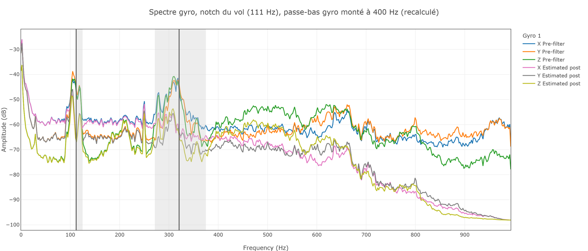
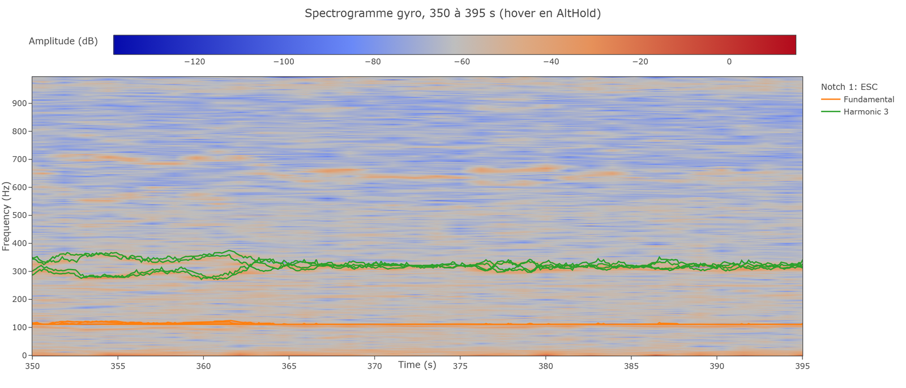
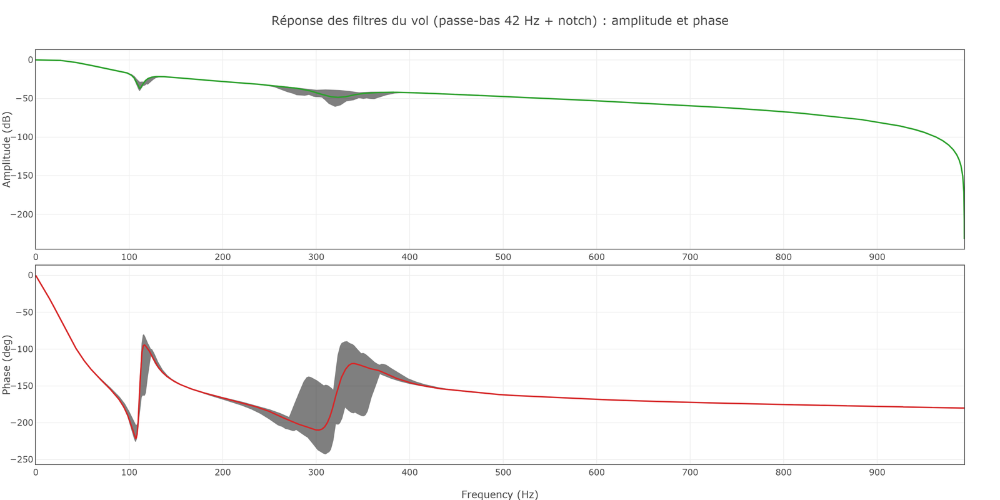
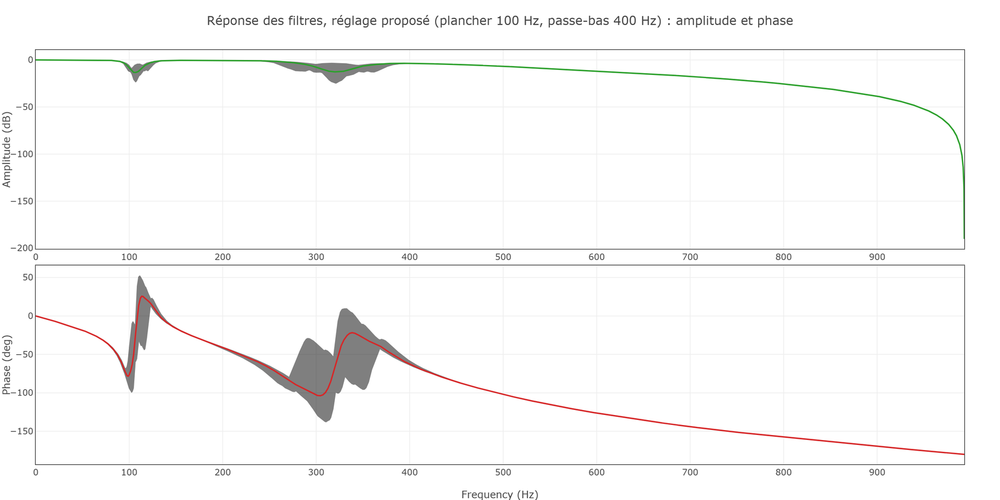
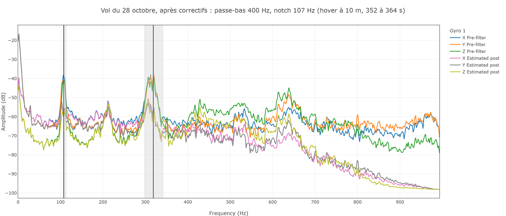

# Formation 9.2 : vibrations et filtres

> [!NOTE]
> **À quoi ça sert en compétition**
> Un drone mal filtré a l'air mal réglé : trop filtré, il réagit en retard ; pas assez, il chauffe ses moteurs et fait trembler la caméra. Les filtres passent avant les PID, et se refont à chaque changement d'hélices ou de charge utile, donc avant chaque compétition.

## Objectifs de la formation

À la fin de cette partie, vous serez capable de :

- Expliquer pourquoi on filtre le gyroscope, et ce que coûte un filtre
- Lire un spectre de vibrations dans Filter Review
- Régler le notch harmonique et le passe-bas gyro pour que tout passe juste sous moins 50 dB

> [!NOTE]
> **Avant de commencer**
> - **Durée** : environ 1 h.
> - **Prérequis** : la formation 9.1, fiche de santé remplie.
> - **À la fin** : un fichier de paramètres de filtres exporté de Filter Review.
> - **Aide** : Discord, salon Contrôle, fil « Formations et Questions », avec la capture de votre spectre.

---

## 1 - Le principe

Les moteurs font vibrer toute la structure à leur fréquence de rotation et à ses multiples. Le gyroscope mesure ces vibrations en plus de la rotation du drone. Sans filtre, le contrôleur essaie de les corriger, et le D, qui réagit aux variations rapides, amplifie tout.

Mais un filtre coûte du **retard** : la mesure filtrée arrive en retard sur la réalité. Deux règles :

- **Le moins de filtres possible.**
- **La cible : chaque pic juste sous moins 50 dB.** Plus bas n'apporte rien et coûte du retard.

Deux filtres suffisent presque toujours :

- le **notch harmonique**, une coupure étroite qui suit la fréquence des moteurs et ses harmoniques ;
- le **passe-bas gyro**, qui retire ce qui est au-dessus d'une fréquence.

---

## 2 - Choisir la portion de vol

Dans Filter Review, chargez le log et choisissez dans « Analysis time » **un hover calme d'au moins 20 à 30 secondes**, sans mouvement franc commandé. Le 27 octobre : **350 à 395 s**, en AltHold, juste avant les coups de stick. Cliquez **Calculate**.

---

## 3 - Lire le spectre

Affichez **pre-filter** : ce que le gyroscope mesure avant tout filtre.

**Qu'est-ce que vous voyez ?**

Réponse

- Un pic vers **105 Hz** : la rotation des moteurs (le RPM de la fiche de santé, divisé par 60).
- Un pic vers **310 Hz** : sa troisième harmonique.
- Les deux dépassent moins 50 dB : ce sont eux qu'on traite. Le reste, on l'oublie.

---

## 4 - Ce que le drone volait

Ajoutez **estimated post-filter** : l'outil calcule ce qui arrive au contrôleur avec les filtres du vol.

**Quel est le problème ?**

Réponse

Tout est écrasé, jusqu'à moins 60 à moins 95 dB : c'est **sur-filtré**. Le passe-bas gyro (`INS_GYRO_FILTER`) est à 42 Hz : il coupe presque tout le spectre, et ajoute environ 115 degrés de retard à 50 Hz.

---

## 5 - Régler, en recalculant

Filter Review permet de changer les paramètres et de cliquer **Recalculate** pour voir l'effet, sans voler.

1. **Passe-bas gyro** : montez `INS_GYRO_FILTER` à **400 Hz**. Recalculez. Le spectre remonte : on voit maintenant ce que fait le notch seul.

   

   Le pic moteur reste à moins 46 dB. Cochez « show notch » : le notch est à **111 Hz**, à droite du pic.

2. **Le plancher du notch** : en mode télémétrie ESC (`INS_HNTCH_MODE` 3), le notch suit le RPM des moteurs, mais ne descend jamais sous `INS_HNTCH_FREQ`. Ici, ce plancher (111 Hz) est au-dessus des moteurs (environ 106 Hz) : le notch reste bloqué. Le spectrogramme le montre, la ligne orange est plate :

   

   Baissez `INS_HNTCH_FREQ` sous le hover le plus lent, à **100 Hz**. Recalculez : le pic passe sous moins 50 dB, et le notch suit chaque moteur.

   

3. **Largeur et profondeur** (`INS_HNTCH_BW`, `INS_HNTCH_ATT`) : on part d'une largeur d'environ un quart de la fréquence, et d'une profondeur juste suffisante pour passer sous moins 50. Ici, 12 et 6 conviennent.

4. **Harmoniques** (`INS_HNTCH_HMNCS`) : la fondamentale, plus l'harmonique qui dépasse (ici la troisième). Rien de plus.

Le retard à 50 Hz passe d'environ 115 degrés à environ 20 :

---

## 6 - Exporter, charger, vérifier

1. **Save Parameters** dans Filter Review, avec le drone et la date dans le nom du fichier.
2. Mission Planner, Config, Full Parameter List : **Load from file**, puis **Write Params**.
3. **Compare Params** avec le même fichier, deux fois : la deuxième comparaison attrape ce que la première a manqué.

C'est l'étape qui se rate le plus souvent : le passe-bas à 42 Hz du 27 octobre avait été décidé à 400 Hz des semaines plus tôt, et n'avait jamais été chargé.

---

## 7 - À quoi ça devrait ressembler

Le lendemain, 28 octobre, le même drone vole avec le passe-bas à 400 Hz et le plancher du notch descendu à 107 Hz. Voici le spectre d'un hover à 10 m :

C'est la référence à viser : les pics bruts (bleu, orange, vert) sont toujours là, à moins 38 dB, mais après filtrage (rose, gris, jaune) chacun passe **juste sous moins 50 dB**, et le spectre n'est pas écrasé ailleurs.

> [!TIP]
> **Tu as réussi si** ton post-filtre estimé ressemble à cette référence : chaque pic juste sous moins 50 dB, avec un seul notch et un passe-bas haut.

---

## 8 - Quand ça casse

| Symptôme | Cause probable | Quoi faire |
|---|---|---|
| Le bouton post-filter est gris | `INS_LOG_BAT_OPT` sans le bit post-filtre | Travailler avec estimated post-filter ; activer le bit pour le prochain vol |
| Pas de pic net | Portion pas calme, ou trop courte | 20 à 30 s de hover sans mouvement franc |
| Le pic n'est pas où le RPM le prédit | `SERVO_BLH_POLES` faux | Corriger avant de régler les filtres |
| Le notch ne suit pas le pic | `INS_HNTCH_FREQ` au-dessus des moteurs | Baisser le plancher sous le hover |

La formation continue avec [9.3 les rates](9.3-les-rates.md).
