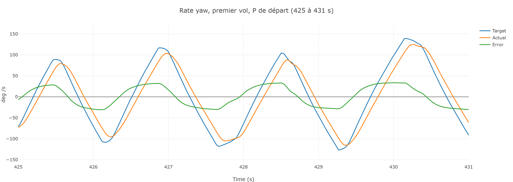
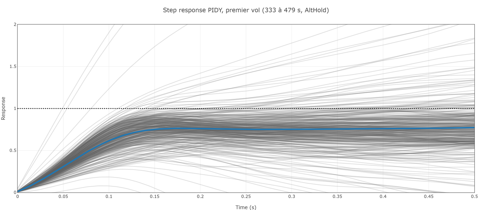
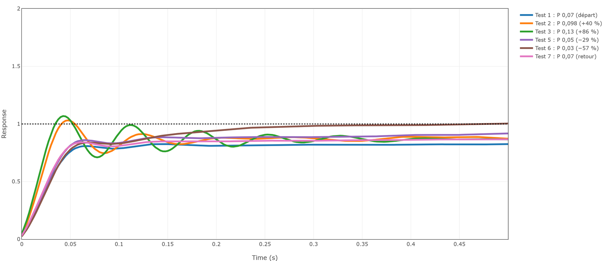
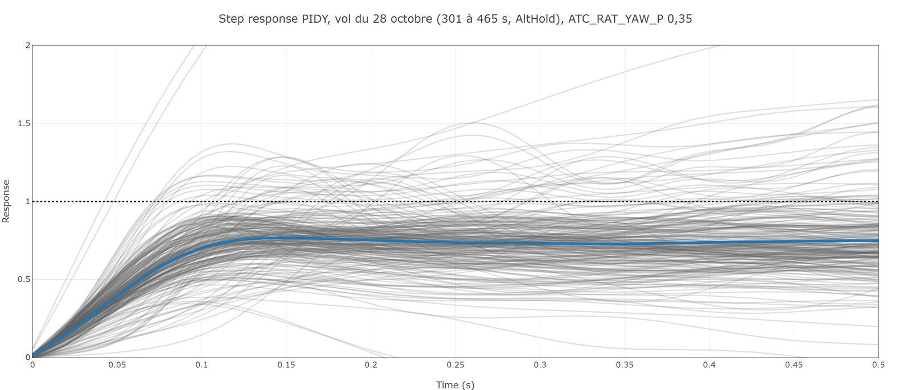

# Formation 9.3 : les rates

> [!NOTE]
> **À quoi ça sert en compétition**
> Le rate est l'étage le plus bas de la chaîne : tout ce que le drone fait passe par lui. Trop mou, le drone subit le vent et la trajectoire flotte ; trop nerveux, il vibre et chauffe ses moteurs. C'est le premier réglage qu'on vérifie sur un drone neuf ou modifié.

## Objectifs de la formation

À la fin de cette partie, vous serez capable de :

- Lire target contre actual et la step response dans PID Review
- Décider quel gain bouger, dans quel sens et de combien
- Comparer plusieurs réglages pris dans un même vol et choisir le bon

> [!NOTE]
> **Avant de commencer**
> - **Durée** : environ 1 h 15.
> - **Prérequis** : les formations 9.1 et 9.2. Les filtres passent avant les rates.
> - **À la fin** : une hypothèse chiffrée pour roll, pitch et yaw.
> - **Aide** : Discord, salon Contrôle, fil « Formations et Questions », avec la capture de la step response.

---

## 1 - Ce que le rate contrôle

Le rate est la vitesse de rotation, en degrés par seconde. Son contrôleur reçoit une consigne de rotation et commande les moteurs pour l'atteindre. Paramètres : `ATC_RAT_RLL_P`, `_I`, `_D` pour le roll ; `PIT` et `YAW` de même. Au départ du vol du 27 octobre : roll et pitch P 0,07, I 0,07, D 0,0018 ; yaw P 0,24.

---

## 2 - Sélectionner et calculer

Dans PID Review, la vue d'ensemble montre tout le vol :

Choisissez **PIDR** (le rate roll), entrez la zone des coups de stick, **333 à 479 s**, et cliquez **Calculate**. Jamais une zone au sol : le drone n'y suit aucune consigne. Recommencez avec **PIDP** et **PIDY**.

---

## 3 - Lire la réponse

### 3.1 - Le time domain

Consigne (Target), mesure (Actual) et écart (Error), sur quelques coups de stick :

En roll, la mesure colle à la consigne avec un léger retard. En yaw, elle arrive en retard et reste sous la consigne à chaque sommet : c'est un **undershoot**.

### 3.2 - La step response

L'outil superpose tous les coups de stick ramenés à 1. **La ligne bleue est la moyenne : c'est elle qu'on lit.**

| Axe | Fin de la ligne bleue | Lecture |
|---|---|---|
| Roll | 0,88 | léger undershoot |
| Pitch | 0,85 | léger undershoot |
| Yaw | 0,77 | undershoot net |

Ce qu'on cherche : **une montée franche, un tout petit dépassement, puis la ligne posée sur 1, sans oscillation**. Sur un gros drone, l'équipe préfère même aucun dépassement.

---

## 4 - Décider du changement

Trois règles :

1. **Le sens.** Undershoot : rendre le contrôleur plus réactif (monter le ratio P sur D). Overshoot ou oscillation : le calmer (baisser le ratio).
2. **Le gain.** Pour calmer, on **baisse P**, on ne monte pas D : D chauffe les moteurs et injecte du bruit. On garde le D le plus petit qui stabilise le drone.
3. **L'ordre de grandeur.** On calcule l'écart comme si c'était linéaire, puis on arrondit vers le haut. Un petit pas ne casse rien ; on converge en quelques vols.

---

## 5 - Comparer des réglages dans un même vol

### 5.1 - Changer un gain en vol

On peut changer un gain **pendant le vol** par la télémétrie, faire quelques coups de stick, et recommencer. Un seul paramètre à la fois, pilote prévenu avant chaque écriture. Le 27 octobre, en AltHold, `ATC_RAT_RLL_P` est passé par six valeurs :

| Test | P | Écart au départ |
|---|---|---|
| 1 | 0,07 | départ |
| 2 | 0,098 | plus 40 % |
| 3 | 0,13 | plus 86 % |
| 5 | 0,05 | moins 29 % |
| 6 | 0,03 | moins 57 % |
| 7 | 0,07 | retour au départ |

PID Review détecte ces changements tout seul et calcule une step response par réglage. Choisissez **PIDR** sur tout le vol, et cliquez **Calculate** :

**Classez les réglages, du plus mou au plus nerveux. Lequel prendriez-vous ?**

Réponse

- **P 0,03 à 0,07** : même montée, puis la courbe plafonne sous 1. Baisser P sous 0,07 ne rend pas le drone plus stable, seulement plus lent.
- **P 0,098** : la montée la plus franche, un petit dépassement (1,03), puis un creux. C'est la limite haute.
- **P 0,13** : la courbe dépasse (1,07) puis **oscille** plusieurs fois avant de se calmer. Trop nerveux.

Le bon réglage est **entre 0,07 et 0,098**. Au-delà, le drone oscille.

Le retour à 0,07 (Test 7) redonne la même courbe que le départ (Test 1) : la comparaison est fiable.

### 5.2 - Ce que l'oscillation donne dans le temps

À P 0,13, la mesure fait des petites vagues autour de la consigne, environ 14 fois par seconde : c'est l'oscillation de la step response. Un pilote ne la sent pas toujours ; les moteurs et la caméra, oui.

> [!NOTE]
> Toujours croiser step response et time domain. Si les deux lectures se contredisent sur un réglage, on ne conclut pas sur celui-là.

---

## 6 - Le cas du yaw

Le yaw n'a pas de D : le drone tourne en accélérant certains moteurs et en ralentissant les autres, il n'y a pas de grosse inertie à freiner. Monter le ratio veut donc dire monter P.

Le 27 octobre, le yaw plafonne à 0,77. Au vol suivant, le 28 octobre, `ATC_RAT_YAW_P` est monté de 0,24 à 0,35 (plus 46 %). Résultat :

La courbe **plafonne toujours, à 0,75**. Pourquoi ? Pendant les coups de yaw du 28 octobre, `RCOU` montre un moteur qui descend jusqu'à **1 090**, le plancher (`MOT_SPIN_MIN`) : il ne peut pas ralentir davantage. Le contrôleur demande plus, les moteurs ne peuvent pas suivre.

Leçon : **si monter P ne change pas le plafond, ce n'est pas P qui le fixe.** On regarde la marge des moteurs (9.4) avant de monter encore.

---

## 7 - Et après

Une fois P et D satisfaisants, le **feed-forward** (`ATC_RAT_*_FF`) réduit le retard restant en anticipant la consigne. On y touche vers le troisième vol, pas avant.

<!-- Position sur AutoTune à valider par Colin avant de l'ajouter. -->

---

## 8 - Quand ça casse

| Symptôme | Cause probable | Quoi faire |
|---|---|---|
| Courbes qui ressemblent à du bruit | Zone au sol ou sans coups de stick | Sélectionner les coups de stick |
| Step response floue | Trop peu de coups, ou coups trop mous | Refaire avec des coups francs |
| Undershoot sur les trois axes | Filtres trop bas | Retour à 9.2 avant de monter les gains |
| Le drone oscille après avoir monté P | Ratio trop haut, ou moteurs sans marge | Redescendre ; vérifier `RCOU` (9.4) |

La formation continue avec [9.4 la chaîne complète et la démarche](9.4-chaine-complete-et-demarche.md).
