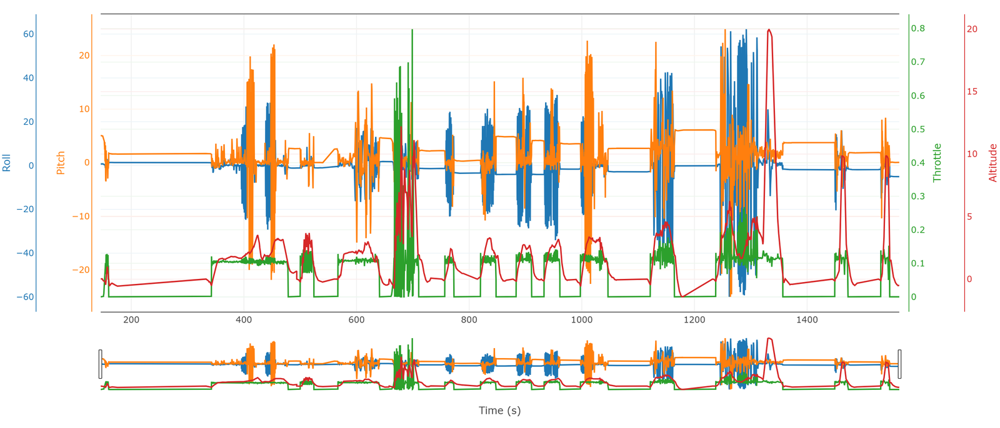
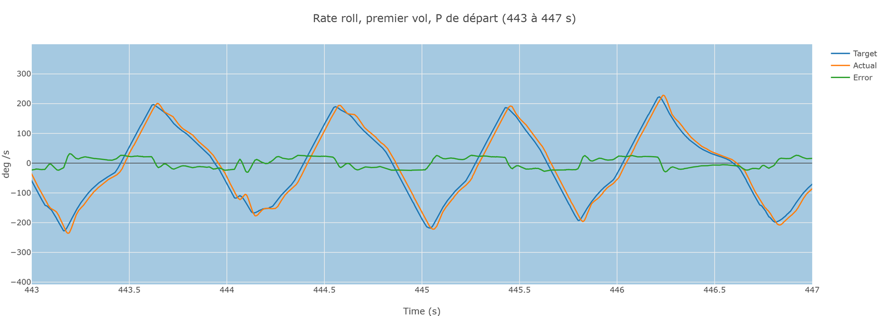
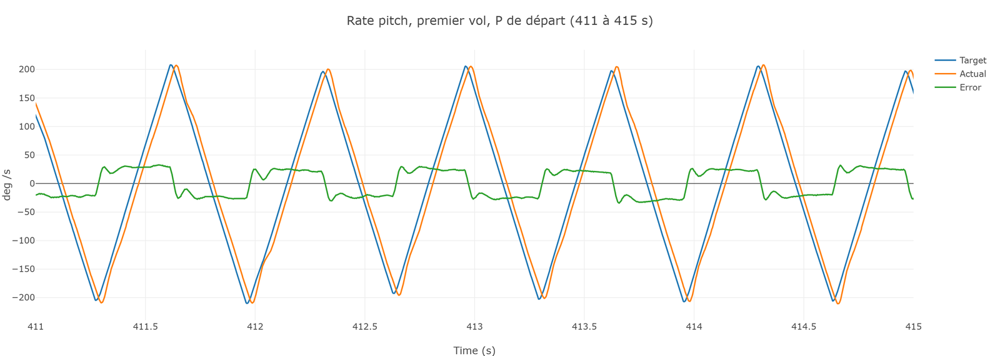
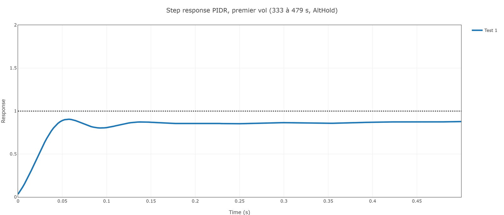
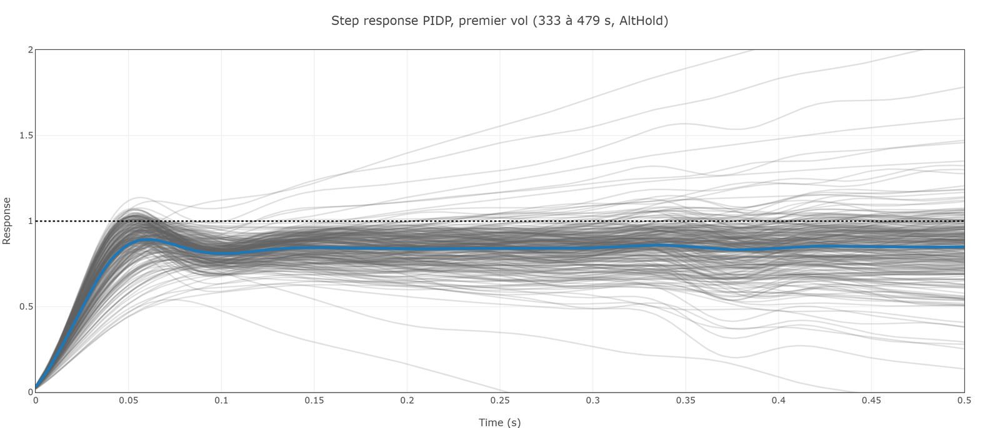
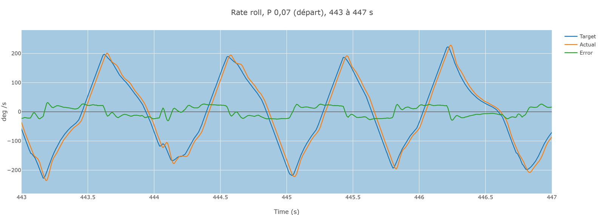
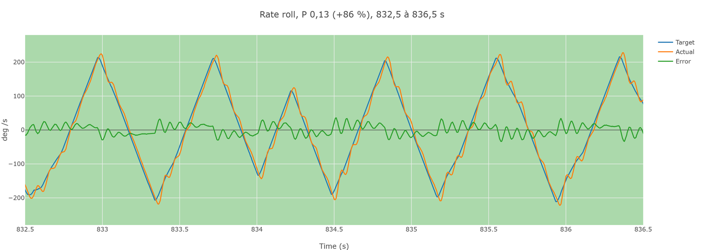
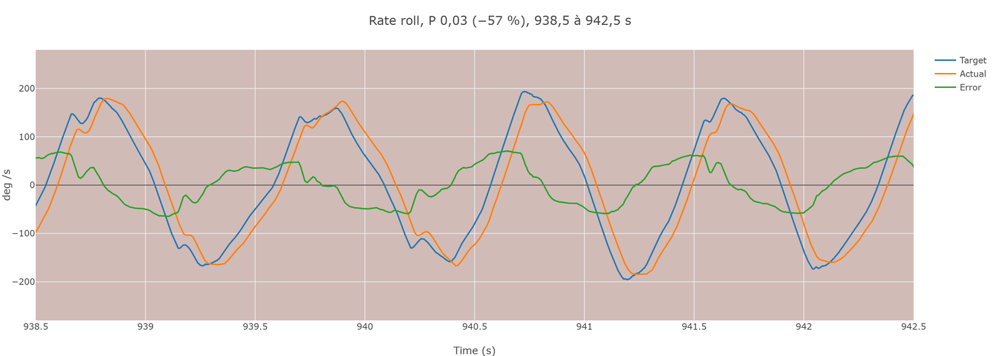

# Formation 9.3 : les rates

> [!NOTE]
> **À quoi ça sert en compétition**
> Le rate est l'étage le plus bas de la chaîne : tout ce que le drone fait passe par lui. Un rate trop mou rend la trajectoire molle et le drone sensible au vent ; un rate trop nerveux fait vibrer l'image de la caméra et chauffer les moteurs. C'est le premier réglage qu'on vérifie sur un drone neuf ou modifié, et souvent le seul qu'on a le temps de retoucher sur le terrain.

## Objectifs de la formation

À la fin de cette partie, vous serez capable de :

- Sélectionner la bonne portion de vol dans PID Review et calculer une réponse
- Lire target contre actual et la step response : undershoot, overshoot, oscillation
- Décider quel gain bouger, dans quel sens et de combien
- Comparer plusieurs réglages du même gain pris dans un même vol, et en tirer le réglage visé

Prérequis : les formations 9.1 et 9.2. Les filtres passent avant les rates : un rate qui a l'air mal réglé est souvent un filtre qui le retarde.

> [!NOTE]
> **Avant de commencer**
> - **Durée** : environ 1 h 30.
> - **Prérequis** : les formations 9.1 et 9.2 faites.
> - **À la fin** : trois hypothèses chiffrées (roll, pitch, yaw) et le réglage visé pour le roll, notés dans votre journal.
> - **Aide** : Discord, salon Contrôle, fil « Formations et Questions », avec la capture de la step response.
> - **À poster à la fin** : la comparaison des sept réglages et vos hypothèses.

---

## 1 - Ce que le rate contrôle

Le contrôleur de rate reçoit une consigne de vitesse angulaire (degrés par seconde) et commande les moteurs pour l'atteindre. En Stabilize et en AltHold, cette consigne vient du contrôleur d'angle, qui la calcule à partir du stick. C'est le premier étage à régler, et le seul pour lequel PID Review calcule une step response.

Paramètres : `ATC_RAT_RLL_P`, `_I`, `_D`, `_FF` pour le roll ; `PIT` et `YAW` de même. Messages : `RATE` et `PIDR`, `PIDP`, `PIDY` (`Tar` contre `Act`). Le détail est dans la [fiche des contrôleurs](fiche-controleurs.md).

Au départ du vol du 27 octobre, roll et pitch ont les mêmes gains (P 0,07, I 0,07, D 0,0018) ; le yaw a P 0,24, I 0,018, D 0.

---

## 2 - Sélectionner et calculer

Dans PID Review, la vue d'ensemble montre roll, pitch, throttle et altitude sur tout le vol :

Deux règles :

- **Jamais une zone au sol.** Le drone n'y suit aucune consigne ; le résultat est n'importe quoi.
- **La zone des coups de stick, un axe à la fois**, puis **Calculate**.

Choisissez **PIDR** (le rate roll), entrez 333 et 479 dans « Analysis time » (la phase 1 du vol, 9.1 section 2.1), cliquez **Calculate**. Recommencez avec **PIDP** et **PIDY**.

---

## 3 - Phase 1 : les trois axes avec les réglages de départ

### 3.1 - Le time domain

L'onglet time domain superpose la consigne (Target), la mesure (Actual) et l'écart (Error). Zoomez sur quelques coups de stick.

**Qu'est-ce que vous voyez, axe par axe ?**

Réponse

- **Roll et pitch** : la mesure suit la consigne de près, avec un léger retard, toujours présent. Les sommets sont presque à la même hauteur (en roll, 236 mesurés pour 233 demandés). Rien d'alarmant.
- **Yaw** : la mesure reste sous la consigne à chaque coup. C'est un **undershoot** net.

Attention : les coups de stick sont des rampes, pas des échelons. Avec une rampe, le contrôleur a le temps de rattraper le sommet ; le time domain flatte le réglage. C'est pour ça qu'on lit aussi la step response.

### 3.2 - La step response

L'outil prend chaque coup de stick, le ramène à 1 et superpose toutes les réponses. Les lignes grises sont les coups un par un ; celles qui partent dans tous les sens viennent de commandes minuscules, on les ignore. **La ligne bleue est la moyenne : c'est elle qu'on lit.**

**Qu'est-ce que vous voyez ?**

Réponse

| Axe | Sommet de la ligne bleue | Fin (0,5 s) | Lecture |
|---|---|---|---|
| Roll | 0,91 | 0,88 | montée franche, plafonne sous 1 : léger undershoot |
| Pitch | 0,89 | 0,85 | pareil |
| Yaw | 0,77 | 0,77 | monte lentement, plafonne à 0,77 : net undershoot |

Aucun axe n'atteint 1. Le roll et le pitch se ressemblent, ce qui est attendu avec les mêmes gains sur un drone presque symétrique.

Ce qu'on cherche dans une step response :

- **Idéal** : une montée franche, un tout petit dépassement, puis stabilisation sur 1, **sans oscillation**.
- **Pour un gros drone** : plutôt aucun dépassement, une arrivée nette sur 1 (amortissement critique). C'est une préférence de l'équipe.
- **Jamais 1** : la courbe plafonne à 0,75 ou 0,8. Le gain ne suffit pas, ou les moteurs ne peuvent pas en faire plus.

---

## 4 - Décider du changement

### 4.1 - Le sens

**Undershoot : monter le ratio P sur D. Overshoot ou oscillation : le baisser.** Monter le ratio rend le drone plus réactif ; le baisser, plus amorti. On raisonne sur le ratio, pas sur les valeurs.

### 4.2 - Le gain qu'on touche

- Pour **monter** le ratio : baisser D, ou monter P.
- Pour **baisser** le ratio : **baisser P**. Pas monter D.

D fait chauffer les moteurs et injecte du bruit : on garde **le D le plus petit qui stabilise le système**. Le guide de Chris Rosser, d'où viennent la plupart de ces règles, va plus loin : pendant cet équilibrage, il ne bouge **que P**, et ne revient à D que si une oscillation ne disparaît pas en baissant P.

### 4.3 - L'ordre de grandeur

Supposez que c'est linéaire, calculez l'écart, puis **arrondissez vers le haut** : la réponse n'est pas linéaire, et un changement calculé comme linéaire est presque toujours trop petit, jamais dangereux. On fait plusieurs vols, on converge.

Le yaw : 0,77 au lieu de 1, il manque environ 30 %. On vise **plus 30 à 40 %** sur `ATC_RAT_YAW_P`, de 0,24 à environ 0,32, en vérifiant d'abord que les moteurs ont la marge (9.4, section 4).

Le roll et le pitch : 0,88 et 0,85, il manque 12 à 15 %. On pourrait calculer de la même façon. Mais ce vol permet mieux : la phase 3 a essayé sept valeurs de P en roll. On va regarder ce que chacune a donné, au lieu de deviner.

---

## 5 - Phase 3 : sept réglages dans un même vol

### 5.1 - Changer un gain en vol

On peut changer un gain **pendant le vol**, par la télémétrie (Mission Planner, Config, Full Parameter List ou Extended Tuning), faire quelques coups de stick, changer encore. C'est ce qui a été fait le 27 octobre, en AltHold, entre 736 et 972 s :

| Test | `ATC_RAT_RLL_P` | Écart au départ | Temps (s) |
|---|---|---|---|
| 1 | 0,07 | départ | jusqu'à 736 |
| 2 | 0,098 | plus 40 % | 736 à 807 |
| 3 | 0,13 | plus 86 % | 807 à 862 |
| 4 | 0,04 | moins 43 % | 862 à 867 |
| 5 | 0,05 | moins 29 % | 867 à 922 |
| 6 | 0,03 | moins 57 % | 922 à 972 |
| 7 | 0,07 | retour au départ | après 972 |

Deux précautions : **un seul paramètre changé à la fois**, et **un pilote prévenu avant chaque écriture**. Des écarts aussi grands (plus 86 %, moins 57 %) ne se font que sur un drone qu'on connaît, à basse altitude, dans un espace dégagé : c'est une démonstration, pas une procédure de réglage.

PID Review détecte ces changements tout seul : le tableau sous la vue d'ensemble liste un « Test » par jeu de paramètres. Le Test 4 n'a duré que 5 secondes, sans coup de stick : l'outil ne peut rien en calculer.

### 5.2 - Les step responses superposées

Choisissez **PIDR**, gardez tout le vol (145 à 1 564 s), cliquez **Calculate**. L'outil calcule une step response par Test et les superpose :

**Avant de lire la suite : classez les réglages, du plus mou au plus nerveux. Lequel prendriez-vous ?**

Réponse

| Test | P | Sommet | Montée à 80 % | Après le sommet | Lecture |
|---|---|---|---|---|---|
| 1 | 0,07 | 0,83 | 40 ms | plat, 0,83 à 0,5 s | undershoot |
| 7 | 0,07 (retour) | 0,85 | 40 ms | plat, 0,87 à 0,5 s | même chose : le réglage se répète |
| 5 | 0,05 | 0,89 | 42 ms | monte lentement jusqu'à 0,92 | undershoot, lent |
| 6 | 0,03 | 0,94 à 0,2 s | 55 ms | rampe jusqu'à 1,00 | lent ; voir 5.4 |
| 2 | 0,098 | **1,03** | 27 ms | un creux à 0,75, puis 0,87 | rapide, petit dépassement, une oscillation |
| 3 | 0,13 | **1,07** | 22 ms | **cinq oscillations** de 70 ms (environ 14 Hz) | trop nerveux |

Trois familles :

- **Les P bas (0,03 à 0,07)** : la montée est la même, environ 40 ms, puis la courbe plafonne sous 1. Baisser P sous 0,07 ne rend pas le drone plus stable, il le rend seulement plus lent à finir.
- **P 0,098** : la montée la plus franche sans emballement. Le dépassement est petit (3 %), mais il est suivi d'un creux : c'est déjà une demi-oscillation de trop pour un drone qu'on veut amorti.
- **P 0,13** : la courbe oscille. C'est la limite : au-delà, le drone tremble.

Le réglage visé est **entre 0,07 et 0,098**.

### 5.3 - Croiser avec le time domain

Toujours comparer la step response à la série temporelle. Zoomez sur quatre secondes de coups de stick dans chaque Test :

Ce qu'on y lit

- **P 0,13** : la mesure (orange) fait des petites vagues autour de la consigne, et l'erreur (vert) oscille vite, environ 14 fois par seconde. C'est l'oscillation de la step response, vue dans le temps. Un pilote ne la sent pas toujours ; les moteurs, la caméra et le log, oui.
- **P 0,07** : la mesure suit la consigne avec un léger retard ; l'erreur reste dans plus ou moins 25 degrés par seconde.
- **P 0,03** : la mesure traîne nettement derrière à chaque changement de sens, reste sous la consigne aux sommets (185 degrés par seconde pour 199 demandés), et l'erreur monte à plus ou moins 60.

Les autres Tests sont dans le dossier `images/` (`9.3-10`, `9.3-12`, `9.3-14`).

### 5.4 - Quand les deux lectures se contredisent

Le Test 6 (P 0,03) a la step response qui finit le plus près de 1, et le time domain le plus mauvais. Qui croire ?

Réponse

Le time domain, pour une raison simple : il montre ce que le drone a fait. La step response de P 0,03 monte lentement vers 1 parce que, avec un P aussi bas, c'est le I (resté à 0,07) qui fait le travail : il accumule l'écart et finit par le combler, en un quart de seconde au lieu de 40 ms. Une step response qui « arrive à 1 » lentement n'est pas une bonne step response. C'est une hypothèse de lecture, pas une mesure : on la vérifierait en refaisant le test avec I changé aussi.

La règle générale : **quand les deux lectures se contredisent, on ne conclut pas sur ce Test-là**. On s'appuie sur ceux où elles sont d'accord (ici 0,07, 0,098 et 0,13).

### 5.5 - Le réglage visé

Ce que les sept Tests permettent de conclure, en partant de ce qui est mesuré :

1. **P 0,07 est trop mou** (plafond à 0,83 à 0,87) et **P 0,13 est trop nerveux** (oscillation à 14 Hz). Mesuré.
2. **P 0,098 est le plus rapide sans oscillation entretenue**, avec un petit dépassement suivi d'un creux. Mesuré.
3. **Le réglage visé est autour de 0,085**, à mi-chemin, soit environ plus 20 % sur le départ : la montée de 0,098 avec un peu plus d'amortissement. C'est une interpolation entre deux Tests, à vérifier en vol.
4. **D reste à 0,0018.** On aurait pu monter le ratio P sur D en baissant D ; ce vol ne l'a pas essayé, donc on ne l'affirme pas.
5. **Le pitch suit le même raisonnement** : mêmes gains, même step response au départ (0,85). Hypothèse : `ATC_RAT_PIT_P` à 0,085 aussi, à confirmer par ses propres coups de stick.
6. **Le plafond sous 1 ne se règle pas avec P.** Même à 0,098, la courbe finit vers 0,87. Ce qui reste est le travail du I et du feed-forward (`ATC_RAT_RLL_FF`), qui anticipe la consigne au lieu d'attendre l'écart. On y touche vers le troisième vol, une fois P et D satisfaisants, un paramètre à la fois.

> [!NOTE]
> **Ce qu'on ne sait pas bien.** Les Tests ne sont pas faits dans les mêmes conditions : la batterie passe de 45,9 à 44,4 V entre le Test 2 et le Test 6, et chaque Test a son propre nombre de coups de stick. Le retour à 0,07 (Test 7) redonne presque la même courbe que le Test 1 (0,85 contre 0,83) : l'effet de la batterie sur ce vol est petit, mais il existe. Une conclusion à 5 % près demanderait plus de vols.

---

## 6 - Le cas du yaw

### 6.1 - Pas de D

`ATC_RAT_YAW_D` vaut 0, et on ne le change pas. Un drone tourne en yaw par **transfert de moment** : il accélère les moteurs qui tournent dans un sens et ralentit les autres. Il n'y a pas de grosse inertie à freiner comme en roll ou en pitch ; l'amortissement de l'air et le temps que mettent les moteurs à changer de régime jouent le rôle du D. « Monter le ratio P sur D » en yaw veut donc dire monter P.

### 6.2 - Pas assez d'autorité

Le yaw est le mouvement le plus exigeant pour les moteurs (9.4, section 4) : ils s'écartent bien plus les uns des autres qu'en roll ou en pitch. Un gros drone, avec de grandes hélices et des moteurs lents à changer de régime, manque d'autorité en yaw et plafonne. La parade mécanique : incliner les moteurs de quelques degrés, pour qu'une partie de la poussée aide la rotation. Un drone à moteurs inclinés **a besoin d'un D en yaw**, parce qu'il y a alors une vraie inertie à freiner.

### 6.3 - Ce que ce vol dit du yaw

Le P yaw est passé de 0,18 à 0,24 après les vols d'août. Le 27 octobre, la step response plafonne encore à 0,77. Une autre hausse est nécessaire : plus 30 à 40 %, soit environ 0,32, en surveillant la marge moteur.

---

## 7 - Le feed-forward et AutoTune

- **Feed-forward** (`ATC_RAT_*_FF`) : il anticipe la consigne à partir de sa pente. Bien réglé, la mesure vient se coller à la consigne ; trop, elle la dépasse. C'est le seul moyen de réduire le retard sans monter tous les gains. Pas avant le troisième vol.
- **AutoTune** : ArduPilot règle seul P et D des rates et des angles en faisant twitcher le drone. L'équipe règle à la main : sur un gros drone, les twitches demandent beaucoup d'espace et peuvent amener les moteurs en butée, et AutoTune ne fait ni les filtres ni les chaînes verticale et horizontale. Il reste un point de départ acceptable sur un petit drone bien filtré, à condition de relire le log après.

<!-- Position à valider par Colin : AutoTune proscrit, toléré comme point de départ sur petit drone, ou autre. Le paragraphe ci-dessus prend la deuxième option. -->

---

## 8 - Quand ça casse

| Symptôme | Cause probable | Quoi faire |
|---|---|---|
| Les courbes ressemblent à du bruit | Zone au sol ou sans coups de stick | Sélectionner les coups de stick, jamais le sol |
| Step response floue, pas de moyenne nette | Trop peu de coups, ou coups trop mous | Refaire avec des coups francs, d'un côté à l'autre |
| Undershoot sur les trois axes | Filtres trop bas (retard) plutôt que gains | Retour à 9.2 avant de monter les gains |
| Un « Test » de PID Review n'a pas de courbe | Pas de coups de stick pendant ce réglage | Faire des coups de stick après chaque changement |
| Step response et time domain se contredisent | Réglage extrême, ou trop peu de données | Ne pas conclure sur ce Test |
| Le drone oscille après avoir monté P | Ratio trop haut, ou marge moteur épuisée | Redescendre ; vérifier `RCOU` (9.4, section 4) |
| Moteurs chauds après le vol | D trop haut, ou vibrations mal filtrées | Baisser D ; revérifier le spectre |

---

## 9 - À poster

La capture des sept step responses superposées, votre classement des réglages et vos hypothèses (paramètre, sens, pourcentage) pour roll, pitch et yaw. La formation continue avec [9.4 la chaîne complète et la démarche](9.4-chaine-complete-et-demarche.md).
