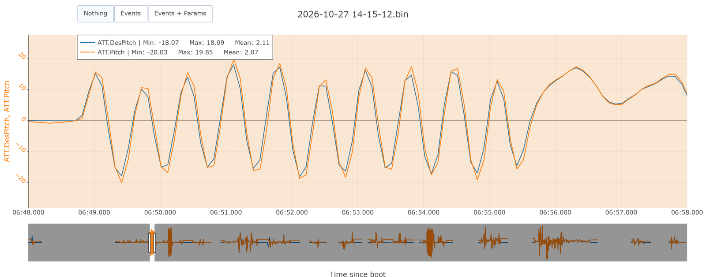
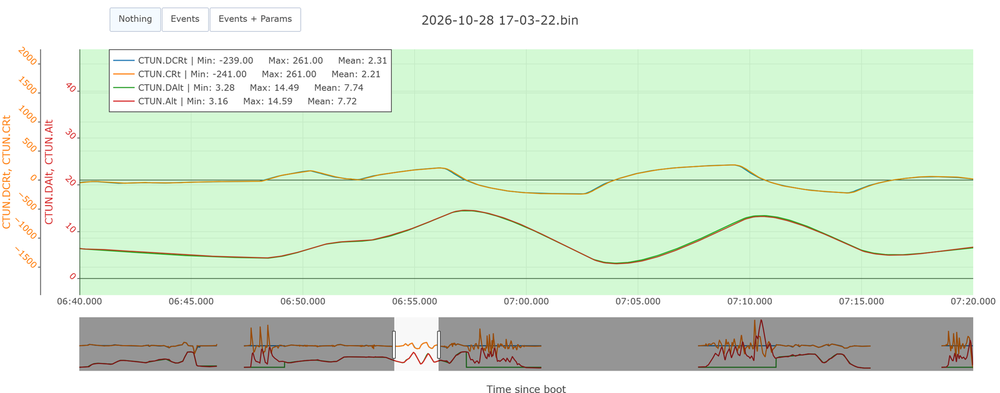

# Formation 9.4 : la chaîne complète et la démarche

> [!NOTE]
> **À quoi ça sert en compétition**
> En mission, angle, vertical et horizontal travaillent ensemble : c'est eux qui décident si le drone arrive au bon point, à la bonne hauteur. Et c'est le journal d'hypothèses, tenu vol après vol, qui fait qu'au jour de la compétition on sait ce qui a été réglé et pourquoi.

## Objectifs de la formation

À la fin de cette partie, vous serez capable de :

- Lire n'importe quel étage de la chaîne avec la même méthode
- Vérifier la marge des moteurs avant de monter un gain
- Tenir le journal d'hypothèses et vérifier ses hypothèses au vol suivant

> [!NOTE]
> **Avant de commencer**
> - **Durée** : environ 1 h.
> - **Prérequis** : les formations 9.1 à 9.3.
> - **À la fin** : le journal du vol du 27 octobre, avec les résultats du vol du 28.
> - **Aide** : Discord, salon Contrôle, fil « Formations et Questions ».

---

## 1 - Le même motif partout

Chaque étage se lit comme le rate : **target contre actual**, undershoot ou overshoot, de bas en haut. Seuls les noms changent ; la [fiche des contrôleurs](fiche-controleurs.md) les donne tous.

| Étage | Dans UAV Log Viewer | Paramètre principal |
|---|---|---|
| Angle | `ATT.DesRoll` contre `ATT.Roll` (idem pitch) | `ATC_ANG_RLL_P`, `ATC_ANG_PIT_P` (un P seul) |
| Vitesse verticale | `CTUN.DCRt` contre `CTUN.CRt` | `PSC_VELZ_P` |
| Accélération verticale | `PIDA.Tar` contre `PIDA.Act` | `PSC_ACCZ_P` |
| Position horizontale | `PSCN.TPN` contre `PSCN.PN` (idem est) | `PSC_POSXY_P` |

Pour comparer deux courbes, mettez-les **sur le même axe** (le menu de numéro d'axe à côté du nom du champ). Et un étage ne se lit que dans un vol qui le fait travailler : on ne règle pas le vertical sans montées ni descentes franches.

---

## 2 - L'angle

Tracez `ATT.DesPitch` et `ATT.Pitch` sur les coups de pitch du premier vol :

La mesure dépasse la consigne d'environ 10 % aux sommets : un léger **overshoot**. L'angle n'a qu'un P ; l'hypothèse est simple : **baisser `ATC_ANG_RLL_P` et `ATC_ANG_PIT_P` d'environ 10 %**. Au vol du 28 octobre, ils passent de 4,05 à 3,7, et l'overshoot descend à 5 à 7 %.

---

## 3 - Le vertical

Le 27 octobre, le pilote ne fait que de petites montées : on ne peut rien conclure, et on note que le prochain vol doit en contenir. Le 28 octobre, il fait des montées et descentes franches en AltHold (jusqu'à 2,5 m/s), avec `PSC_ACCZ_P` monté de 0,18 à 0,25 :

C'est la référence à viser : la vitesse mesurée (orange) se superpose à la vitesse demandée (bleu), l'altitude mesurée à l'altitude demandée. Rien à changer.

---

## 4 - La marge des moteurs

Avant de monter un gain, on regarde ce que les moteurs ont encore à donner. Tracez `RCOU.C1` à `C4` pendant les coups de stick :

- La plage utile va de `MOT_SPIN_MIN` (environ **1 090** ici) à **2 000**.
- Le **yaw** écarte les moteurs le plus : c'est le mouvement le plus exigeant.
- Le 27 octobre, en yaw, un moteur descend à 1 136 : il reste peu de marge en bas. Le 28 octobre, avec le P yaw monté, il touche **1 090**. Le drone ne peut plus en faire plus : c'est pour ça que le yaw plafonne (9.3, section 6).

Un moteur qui touche le plancher ou le plafond, c'est un contrôleur qui demande ce que le drone ne peut pas faire. Monter le gain n'y change rien.

---

## 5 - La boucle : hypothèse, vol, résultat

Le tuning ne se fait pas en un vol. On note une hypothèse par contrôleur, on vole, on vérifie, on recommence. Un drone se règle en 3 à 10 vols, de bas en haut, et les filtres se revérifient à chaque fois.

Le journal tient en un tableau. Voici celui du 27 octobre, avec ce que le vol du 28 a montré :

| Contrôleur | Observation (27 oct.) | Hypothèse | Appliqué (28 oct.) | Résultat |
|---|---|---|---|---|
| Filtres | sur-filtré (42 Hz), notch bloqué au-dessus des moteurs | passe-bas 400 Hz, plancher du notch plus bas | 400 Hz, plancher 107 Hz | pics juste sous moins 50 dB : la référence (9.2) |
| Rate roll, pitch | 0,88 et 0,85 ; 0,13 oscille | rester entre 0,07 et 0,098 | 0,068 | inchangé (0,90 et 0,84) |
| Rate yaw | plafonne à 0,77 | P plus 30 à 50 % | 0,24 → 0,35 | plafonne à 0,75 : moteurs au plancher |
| Angle | overshoot 10 % | P moins 10 % | 4,05 → 3,7 | overshoot 5 à 7 % |
| Vertical | pas de montée franche | rien ; montées au prochain vol | `PSC_ACCZ_P` 0,18 → 0,25 | bien suivi (référence, section 3) |
| Horizontal | pas de déplacement franc | rien | | |

La colonne « résultat » est celle qui fait converger : une hypothèse sans résultat noté est perdue. Le journal se tient dans la page Notion « Analyse de test de vol », une ligne par vol.

### Ce que le prochain vol doit contenir

1. Les nouveaux paramètres, chargés et comparés deux fois.
2. Un hover calme de 30 secondes, à 5 m ou plus.
3. Coups de stick roll, pitch, yaw en AltHold, batteries pleines.
4. Montées et descentes franches ; déplacements francs en Loiter, un axe à la fois.

---

## 6 - À poster

Votre journal (section 5) dans le fil « Formations et Questions », comparé avec [solutions/journal-vol-tuning-2026-10-27.md](solutions/journal-vol-tuning-2026-10-27.md). C'est la fin de la formation 9.
