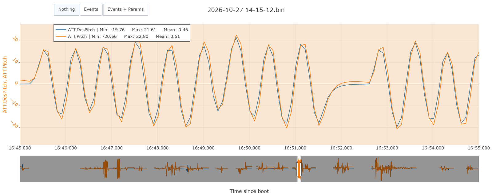
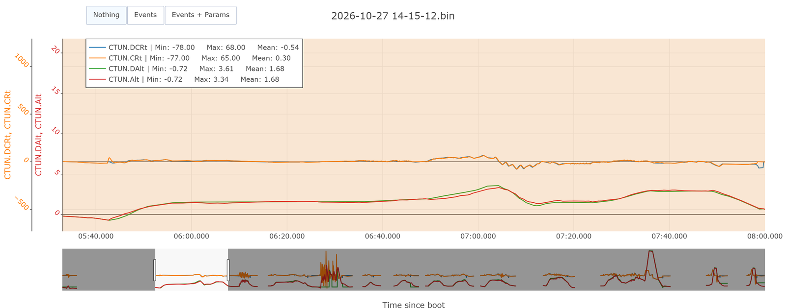
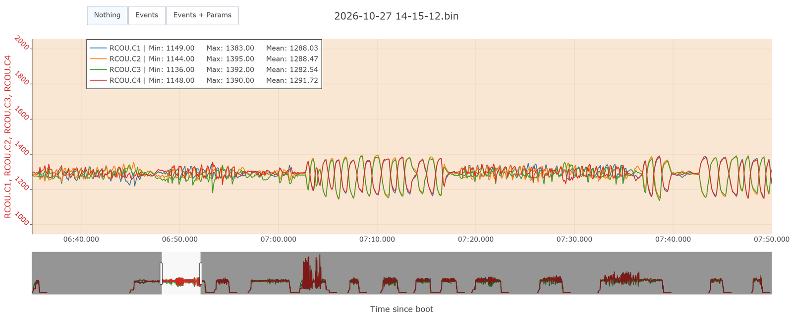
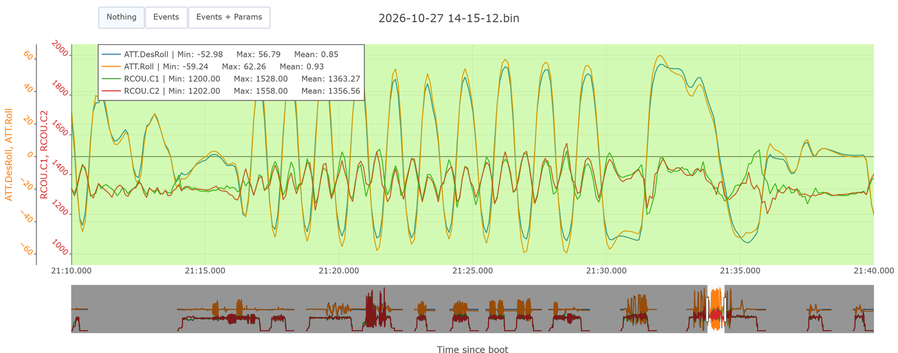

# Formation 9.4 : la chaîne complète et la démarche

> [!NOTE]
> **À quoi ça sert en compétition**
> En mission, le drone vole en Guided ou en Auto : angle, vertical et horizontal travaillent ensemble. C'est cette chaîne qui décide si le drone arrive au bon point, à la bonne hauteur, sans dépasser. Et c'est le journal d'hypothèses, tenu vol après vol, qui fait qu'au jour de la compétition on sait ce qui a été réglé, pourquoi, et ce qu'il ne faut plus toucher.

## Objectifs de la formation

À la fin de cette partie, vous serez capable de :

- Lire target contre actual pour l'angle, la chaîne verticale et la chaîne horizontale dans UAV Log Viewer
- Vérifier la marge de contrôle des moteurs avant de monter un gain
- Reconnaître un essai qui ne permet pas de conclure, et le dire
- Tenir le journal d'hypothèses d'un drone et écrire ce que le prochain vol doit contenir

Prérequis : les formations 9.1 à 9.3.

> [!NOTE]
> **Avant de commencer**
> - **Durée** : environ 1 h 30.
> - **Prérequis** : les formations 9.1 à 9.3 faites, avec leurs hypothèses notées.
> - **À la fin** : le journal complet du vol du 27 octobre, comparé à la solution.
> - **Aide** : Discord, salon Contrôle, fil « Formations et Questions ».
> - **À poster à la fin** : votre journal (section 6).

---

## 1 - Le même motif partout

Tous les contrôleurs de la chaîne se lisent de la même façon : target contre actual, undershoot ou overshoot, de bas en haut. Ce qui change d'un étage à l'autre, ce sont les noms des messages, des champs et des paramètres, et ArduPilot n'est pas cohérent (un D veut dire « desired » dans un message et « dérivée » dans un paramètre). C'est la raison d'être de la [fiche des contrôleurs](fiche-controleurs.md). Ouvrez-la à côté.

Dans UAV Log Viewer, pour comparer deux champs, mettez-les **sur le même axe** (le petit menu de numéro d'axe à côté du nom du champ, dans « Plots Setup ») ; sinon chaque courbe a sa propre échelle et l'œil compare n'importe quoi.

Deux vérifications valables pour tous les étages :

- **Le pas de temps est constant** : c'est le loop rate de la fiche de santé (9.1). S'il varie, le D et le I sont faux.
- **Le rapport signal sur bruit vaut au moins 10** : si la mesure vibre autour de la consigne avec plus d'un dixième de l'amplitude du signal, on filtre avant de régler les gains.

---

## 2 - Les contrôleurs d'angle

Message `ATT` : `DesRoll` contre `Roll`, `DesPitch` contre `Pitch`. Paramètres `ATC_ANG_RLL_P`, `ATC_ANG_PIT_P`. **Il n'y a qu'un P** : l'inertie du drone est l'affaire du rate ; l'angle envoie une consigne de rate proportionnelle à l'écart d'angle, et c'est tout.

Le 27 octobre, `ATC_ANG_PIT_P` est passé de 4,05 à 3,0 (moins 26 %) à 982 s, le temps d'une série de coups de pitch, puis est revenu à 4,05 à 1 068 s. Tracez `ATT.DesPitch` et `ATT.Pitch` sur le même axe, et comparez une série de coups avec chaque réglage :

**Qu'est-ce que le changement a donné ?**

Réponse

Rien de visible. Avec les deux réglages, la mesure dépasse un peu la consigne aux sommets (environ 10 %, médiane 1,11 avec 4,05 et 1,09 avec 3,0) et la suit avec le même petit retard. La consigne de rate demandée pendant les coups est la même aussi (environ 180 à 190 degrés par seconde).

Deux raisons, et c'est la vraie leçon de cet essai :

- **Le message `ATT` est enregistré à 10 Hz** dans ce log : un point tous les dixièmes de seconde, trop peu pour voir une différence de quelques dizaines de millisecondes.
- **Les coups de stick à fond saturent la chaîne** : à pleine déflexion, c'est le lissage du stick (`ATC_INPUT_TC`) et les limites d'accélération qui décident de la consigne, pas le P d'angle. Le P d'angle se voit mieux sur de petites corrections et sur le maintien d'attitude face au vent.

**Un essai qui ne montre rien est un résultat.** On l'écrit dans le journal (« ANG_PIT_P 3,0 : pas de différence mesurable avec des coups à fond ») et on ne change rien. L'overshoot d'environ 10 % en angle était déjà là en août ; il ne justifie pas un changement tant que le rate n'est pas réglé (on règle de bas en haut).

---

## 3 - La chaîne verticale

Trois étages, à lire en AltHold, là où le pilote commande une vitesse verticale et où la chaîne travaille sans l'horizontale :

| Étage | Message et champs | Paramètres |
|---|---|---|
| Vitesse verticale | `CTUN.DCRt` contre `CTUN.CRt` | `PSC_VELZ_P` et voisins |
| Accélération verticale | `PIDA.Tar` contre `PIDA.Act` | `PSC_ACCZ_P`, `_I` |
| Position verticale | `CTUN.DAlt` contre `CTUN.Alt` | `PSC_POSZ_P` |

Tracez `CTUN.DCRt`, `CTUN.CRt` (un axe), `CTUN.DAlt`, `CTUN.Alt` (un autre axe) sur le premier vol, 333 à 480 s :

**Qu'est-ce que vous voyez ?**

Réponse

Les courbes se superposent : la vitesse mesurée suit la consigne (pente de 0,94 sur les montées et descentes), l'altitude suit l'altitude demandée. Mais le pilote n'a demandé que plus ou moins 0,7 m/s et l'altitude n'a varié qu'entre 0 et 3,3 m : il n'y a pas de montée ni de descente franche. **On ne touche pas**, et le prochain vol doit en contenir. `PIDA` se lit de la même façon, avec la même conclusion tant que le vol ne contient pas de montée franche.

---

## 4 - La marge de contrôle

Avant de monter n'importe quel gain, on regarde ce que les moteurs ont encore à donner. Message `RCOU`, champs `C1` à `C4` : les sorties moteurs en PWM.

- La plage utile va de `MOT_SPIN_MIN` (0,09 sur le Crash Proof, soit environ **1 090**) à **2 000**.
- Un moteur qui touche le plancher ne peut pas donner moins ; au plafond, il ne peut pas donner plus. Dans les deux cas, le contrôleur demande ce que le drone ne peut pas faire. Le plancher se rattrape souvent ; le plafond est grave.

Tracez `RCOU.C1` à `C4` sur les coups de stick du premier vol (395 à 470 s). La séquence est roll, pitch, yaw, puis une deuxième fois.

**Qu'est-ce que vous voyez ?**

Réponse

| Coups de stick | Moteur le plus bas | Moteur le plus haut |
|---|---|---|
| Roll | 1 229 | 1 349 |
| Pitch | 1 179 | 1 357 |
| Yaw | **1 136** | 1 392 |

- Le **yaw** écarte les moteurs le plus : c'est le mouvement le plus exigeant (9.3, section 6).
- Le plafond est loin : le Crash Proof tient en l'air à 12,5 % de throttle (9.1, section 5.5).
- Le plancher, lui, est proche : en yaw, un moteur descend à 1 136, à **46 points** de 1 090. C'est le profil d'un drone très motorisé : il touchera le plancher avant le plafond.

Conséquence directe pour 9.3 : monter `ATC_RAT_YAW_P` de 30 à 40 % écartera encore plus les moteurs en yaw. La marge du bas risque de ne pas suffire. On monte par étapes, en relisant `RCOU` à chaque vol.

Une autre lecture des moteurs : à 699 s, en Stabilize, le pilote pousse les gaz à 1 841 ; un moteur touche 2 000 et le drone monte à 8,5 m/s. En Stabilize, le throttle est au pilote : ce n'est pas un problème de contrôle. En vol autonome, des moteurs qui collent au plafond voudraient dire gains ou limites trop agressifs.

---

## 5 - La chaîne horizontale et l'extrait agressif

À lire en Loiter ou Guided. Messages `PSCN` (nord) et `PSCE` (est), qui regroupent position (`TPN` contre `PN`), vitesse (`TVN` contre `VN`) et accélération (`TAN` contre `AN`). Paramètres `PSC_POSXY_P`, `PSC_VELXY_P`, `_I`, `_D`.

Le 27 octobre, les portions en Loiter sont du vol libre : pas de déplacement franc, un axe à la fois, suivi d'un arrêt net. **Il n'y a rien à régler** : on regarde comment la position est tenue, et on écrit ce que le prochain vol doit contenir. Les valeurs par défaut d'ArduPilot font un travail correct sur ces étages, et on les règle en dernier.

Le vol se termine par une phase agressive : `ANGLE_MAX` monté à 60 puis 80 degrés, roulis jusqu'à 62 degrés. Ce n'est pas un vol de tuning, mais un extrait montre ce qu'un drone bien réglé encaisse :

Ce qu'on y lit

- La mesure suit la consigne jusqu'à 60 degrés, avec un petit dépassement aux sommets (62 pour 57) : le même overshoot d'angle d'environ 10 % qu'en section 2.
- Les moteurs restent entre 1 160 et 1 558 : même à 60 degrés de roulis, ce drone a de la marge.
- Ce genre de test vient **à la fin** de la démarche (section 6.1, étape 5), une fois les PID solides, jamais sur un drone qu'on règle encore.

---

## 6 - Le journal d'hypothèses et l'ordre des vols

### 6.1 - La démarche complète

1. **Réglage initial** d'après les fiches techniques : filtres larges, gains prudents, limites basses.
2. **Premier vol** de tuning, comme celui du 27 octobre : modes montés un à un, hover calme, coups de stick par axe en AltHold, batteries pleines.
3. **Revue** : la fiche de santé, puis les filtres, puis les rates, puis le reste. On en sort avec des hypothèses, pas des certitudes.
4. **3 à 10 vols** pour valider et affiner, de bas en haut. Les filtres se revérifient à chaque fois.
5. **Agressivité** : une fois les PID solides, monter les limites (`ATC_RATE_*_MAX`, `ATC_ACCEL_*_MAX`, `ANGLE_MAX`, `LOIT_*`, `WPNAV_*`) en vérifiant que le drone atteint la commande et que les moteurs gardent leur marge.
6. **Feed-forward** vers le troisième vol.
7. **Refaire les filtres** à tout changement mécanique ou de charge utile.

### 6.2 - Le journal

Une ligne par contrôleur et par vol. La colonne « résultat au vol suivant » se remplit après le vol suivant : c'est elle qui fait converger. Une hypothèse sans résultat noté est une hypothèse perdue.

| Vol | Contrôleur | Observation | Hypothèse (paramètre, sens, %) | Appliqué ? | Résultat au vol suivant |
|---|---|---|---|---|---|
| 27 oct. | Filtres | passe-bas à 42 Hz (sur-filtré) ; notch bloqué à 111 Hz, moteurs à 106 Hz | `INS_GYRO_FILTER` 400 ; `INS_HNTCH_FREQ` 100 | | |
| 27 oct. | Rate roll | 7 réglages : 0,07 plafonne à 0,83, 0,13 oscille à 14 Hz | `ATC_RAT_RLL_P` 0,085 (plus 20 %) | | |
| 27 oct. | Rate pitch | 0,85 au départ, comme le roll | `ATC_RAT_PIT_P` 0,085, à vérifier | | |
| 27 oct. | Rate yaw | plafonne à 0,77 | `ATC_RAT_YAW_P` plus 30 % par étapes, marge moteur à surveiller | | |
| 27 oct. | Angle pitch | 4,05 et 3,0 : pas de différence mesurable | rien | | |
| 27 oct. | Vertical | bien suivi, pas de montée franche | rien ; montées franches au prochain vol | | |
| 27 oct. | Horizontal | pas de déplacement franc | rien ; déplacements francs au prochain vol | | |

Où le tenir : la page Notion « Analyse de test de vol » a une table par véhicule. Une ligne par vol là, et ce tableau en sous-page.

### 6.3 - Ce que le prochain vol doit contenir

1. Les paramètres du journal chargés, **vérifiés par deux comparaisons** (9.2, section 8).
2. `INS_LOG_BAT_OPT` avec le bit post-filtre, `LOG_FILE_DSRMROT` à 1, et `BATT_ARM_VOLT` au-dessus de `BATT_LOW_VOLT` plus le sag.
3. **30 à 40 secondes de hover calme**, à 5 m ou plus, en début de vol.
4. Coups de stick roll, pitch, yaw en AltHold, batteries pleines, pour valider le nouveau rate.
5. Montées et descentes franches en AltHold ; déplacements francs et arrêts nets en Loiter, un axe à la fois.

---

## 7 - Le log dit ce qui s'est vraiment passé

Les logs ne servent pas qu'au tuning. Quand un vol tourne mal, ils disent ce qui s'est vraiment passé, y compris ce que le pilote n'a pas vu ou ne se rappelle pas. La méthode : croiser deux courbes qui parlent du même moment.

- **Entrées pilote** : `RCIN.C1` à `C4` (sur la manette du Crash Proof : roll, pitch, gaz, yaw). Une valeur va de 1 000 à 2 000, centre à 1 500. Un stick « au centre » n'est jamais exactement à 1 500.
- **Sorties moteurs** : `RCOU`, contre l'entrée pilote du même instant.
- **Altitudes** : `CTUN.Alt` (estimée, depuis le décollage), `BARO.Alt`, `GPS.Alt` (niveau de la mer). Le Crash Proof n'a pas de rangefinder : son altitude estimée dérive avec le baromètre.
- **Événements et messages** : `EV`, `MSG`, `MODE`, pour dater tout le reste.

**On valide toujours ce que le pilote dit avoir fait contre ce que le log montre**, sans que ce soit un reproche. Les doigts réagissent plus vite que la mémoire : c'est la seule façon de séparer une erreur de pilotage d'une erreur logicielle. Le pilote a raison sur l'intention ; le log a raison sur les faits.

---

## 8 - Quand ça casse

| Symptôme | Cause probable | Quoi faire |
|---|---|---|
| Target et actual semblent décalés en amplitude | Axes différents | Mettre les deux champs sur le même axe |
| `PIDA` ou `PSCN` absents | Bit PID de `LOG_BITMASK` inactif, ou mode qui n'utilise pas cet étage | Vérifier le mode ; corriger `LOG_BITMASK` |
| Un changement de gain ne montre aucun effet | Message trop lent, ou essai qui sature la chaîne | Le noter tel quel ; refaire avec de plus petites corrections |
| L'angle traîne alors que le rate est bon | Souvent normal au premier vol ; ou filtre trop bas | Ne pas toucher l'angle ; retour à 9.2 |
| Des moteurs collent au plancher ou au plafond en vol autonome | Gains ou limites trop agressifs, ou drone mal motorisé | Redescendre ; relire le hover appris |
| Le pilote et le log ne disent pas la même chose | C'est normal | Le log a raison sur les faits |

---

## 9 - À poster

Votre journal complet du vol du 27 octobre (section 6.2, plus la fiche de santé de 9.1 et les filtres de 9.2) dans le fil « Formations et Questions ». Comparez-le ensuite avec [solutions/journal-vol-tuning-2026-10-27.md](solutions/journal-vol-tuning-2026-10-27.md). C'est la fin de la formation 9 ; la suite se passe sur un vrai drone, au prochain vol de tuning de l'équipe.
